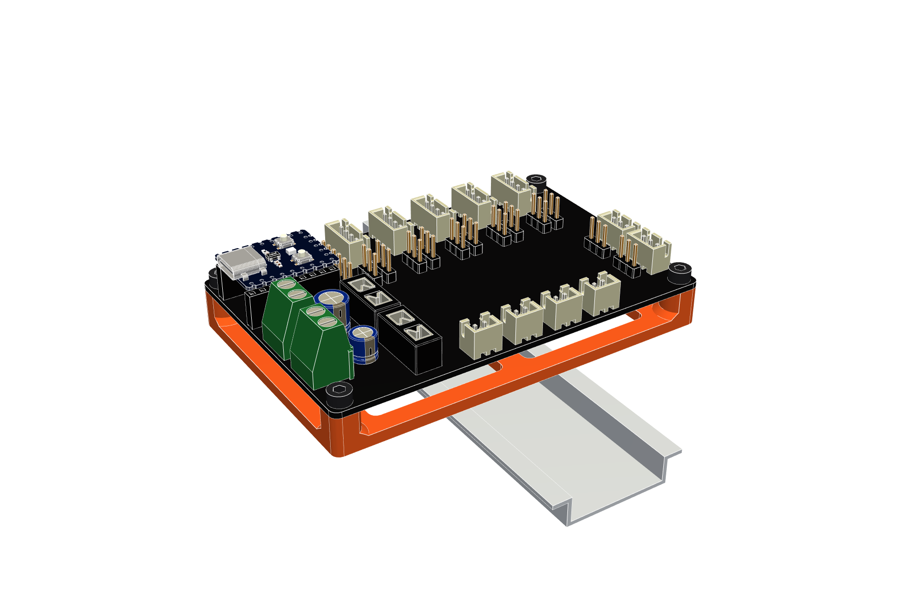
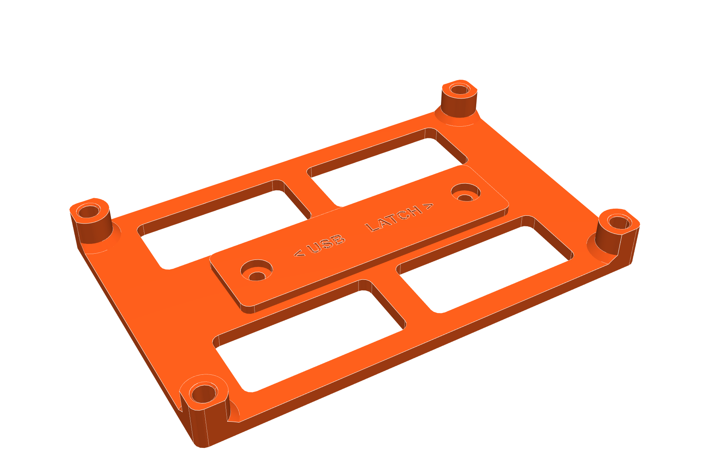
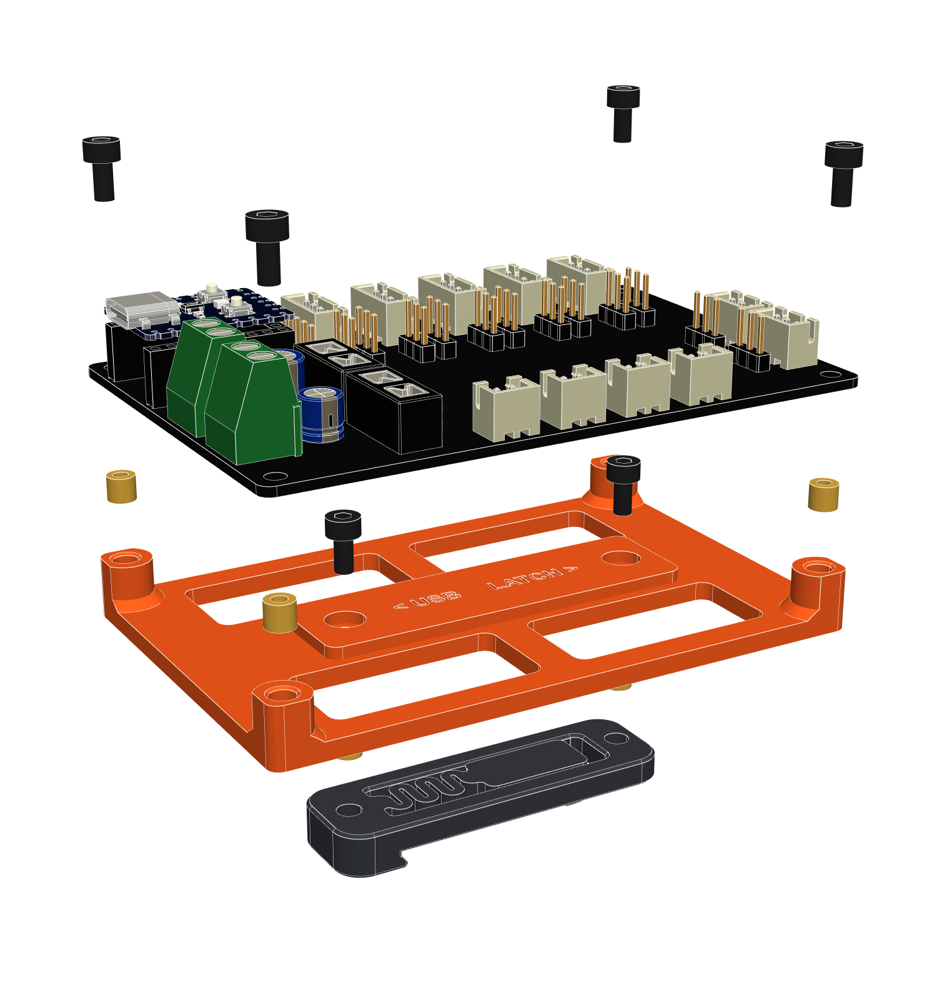
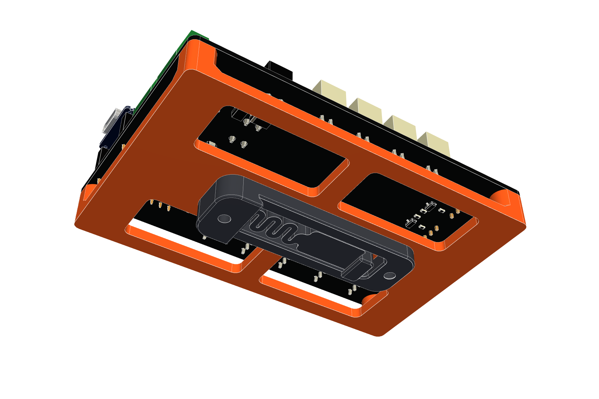
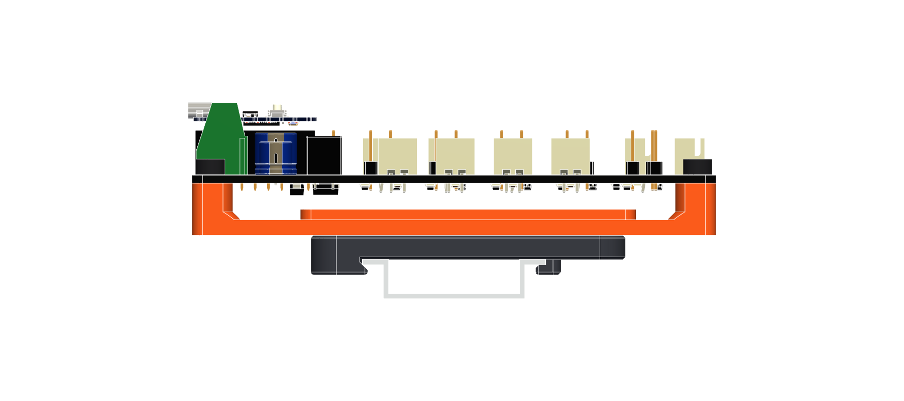

# DIN rail mount

A 3D-printed tray that holds the TinyFan2350 on a 35 mm **DIN rail**. It uses one
[DIN Rail Clip (Heat Insert Version)](https://www.printables.com/model/537942-din-rail-clip-heat-insert-version) by Maxstupo.
The board sits **across** the rail: its long side (100 mm) points away from the rail and it takes 65 mm of rail length.

| | |
|---|---|
| Printed part | [`STL/TinyFan2350_DIN_Mount.stl`](../STL/TinyFan2350_DIN_Mount.stl) |
| CAD | [`TinyFan2350_DIN_Mount.step`](./TinyFan2350_DIN_Mount.step), CadQuery source [`TinyFan2350_DIN_Mount.py`](./TinyFan2350_DIN_Mount.py) |
| Footprint | 100 x 65 mm, the same as the PCB. Nothing sticks out past the board outline |
| Height | 10 mm (3 mm plate + 7 mm standoffs). PCB underside sits 14.6 mm in front of the rail face; about 33 mm from the back of the clip to the top of the tallest part |
| Rail | The rail centre line is under the middle of the board |

The clip is not included here (it is licensed CC BY-NC-SA) - download and print it from Printables.

## Parts

| Qty | Part | Notes |
|---|---|---|
| 1 | Printed mount | this folder |
| 1 | DIN Rail Clip (Heat Insert Version) | [Printables 537942](https://www.printables.com/model/537942-din-rail-clip-heat-insert-version/files) |
| 6 | M3 heat-set insert, M3 x D4.6 x L4.0 | 4 in the mount's standoffs, 2 in the clip (the size the clip is designed for) |
| 2 | M3x6 screw, socket head or button head | mount -> clip. M3x8 also fits |
| 4 | M3x6 screw | PCB -> mount |

## Print settings
- ABS / ASA (or PETG if the electronics bay stays cool), 0.2 mm layers, 4 walls, 5 top/bottom layers, 40 % infill.
- Print it **flat side down**, as exported. No supports.
- The only bridge is the 0.4 mm deep relief pocket on the underside (12 mm span).

## Assembly

1. Press the two M3 inserts into the **flat face** of the clip and the four M3 inserts into the standoffs of the mount
   with a soldering iron (about 220-250 C), flush with the surface.
2. Put the clip against the underside of the mount, flat face to the mount. The **fixed hook** (thick end) goes to the
   side marked `< USB`, the **spring latch** to the side marked `LATCH >`.
3. Screw the clip on from the top with 2 x M3x6. The heads sit in the counterbores of the raised spine.
4. Fit the PCB with 4 x M3x6. The USB-C / power-input edge goes to the side marked `< USB`.
5. Hook the fixed end over one edge of the rail and press the other side down until the latch snaps in. On a horizontal
   rail the USB-C / power end is at the top. To remove the board, push the latch back with a flat screwdriver.

## Design notes
- Clip dimensions were measured from the designer's STEP file: 60 x 18 mm flat face, two insert holes (4.2 mm, 4 mm deep)
  **51 mm** apart, rail seat 9.8 mm from the hook end.
- The shallow pocket under the clip keeps the mount clear of the clip's print-in-place latch and spring, so the latch
  slides freely. Set `SLIDER_RELIEF_DEPTH = 0` for a flat underside.
- 7 mm under the PCB: the tallest bottom-side part is 2.4 mm and the through-hole leads stick out about 2 mm, so
  untrimmed leads still fit.
- Checked against the board's 3D model: no part of the board touches the tray (smallest gap 1.7 mm).
- The standoffs are cut flush with the board outline, so the insert has 1.4 mm of wall on the two outer sides. Press the
  inserts in gently.
- To change anything (standoff height, insert size, clip position, label), edit the parameters at the top of
  `TinyFan2350_DIN_Mount.py` and run it with [CadQuery](https://github.com/CadQuery/cadquery) 2.x
  (`pip install cadquery`, then `python TinyFan2350_DIN_Mount.py`). It writes the STEP and the STL.
- This mount has **not been printed or test-fitted yet**.

