## Pictures

### Board
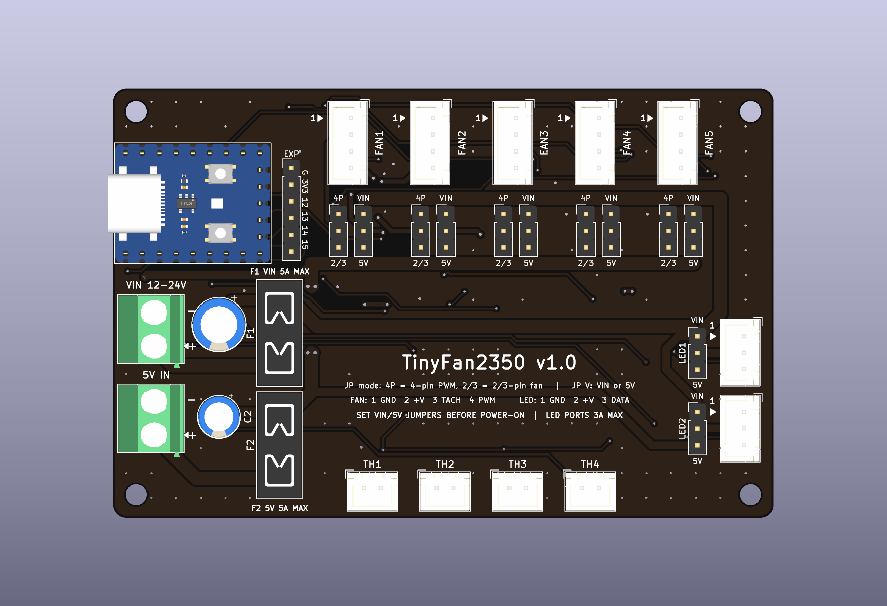
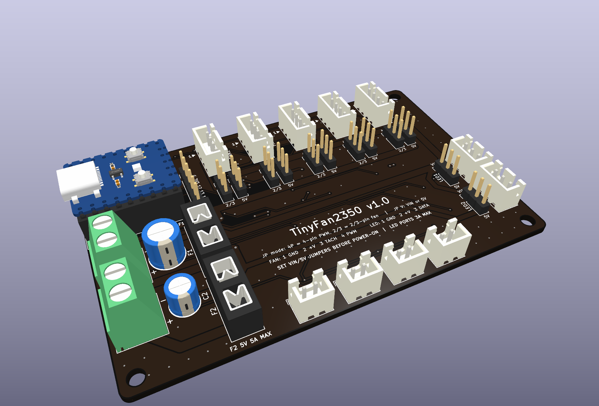

### Pinout, jumpers, wiring
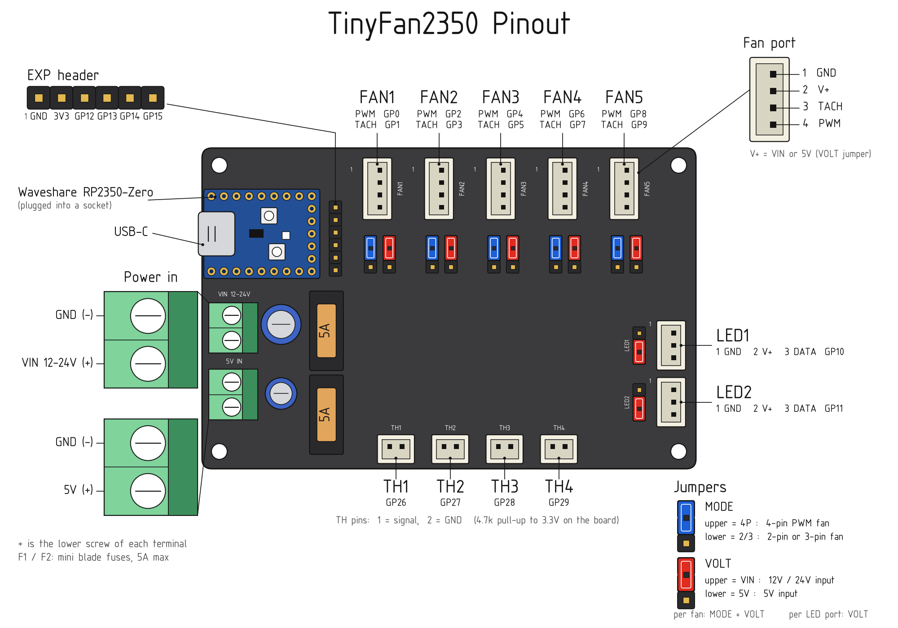
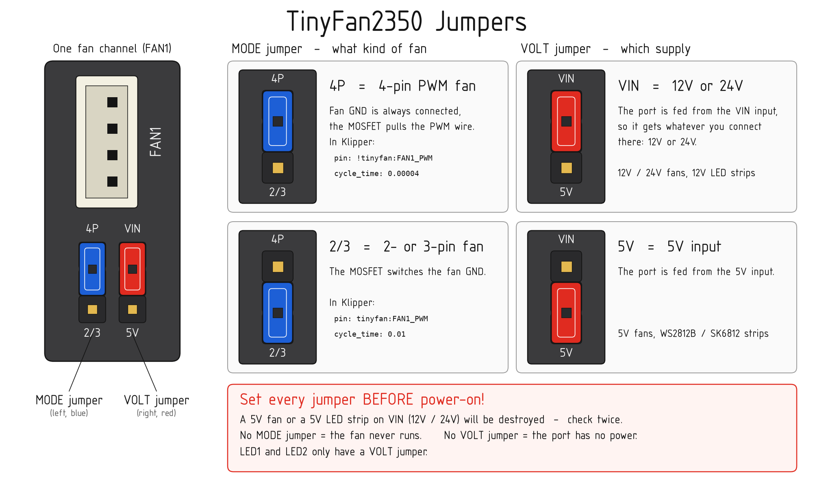
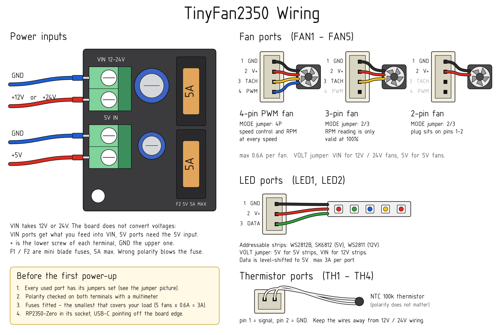

### Flashing
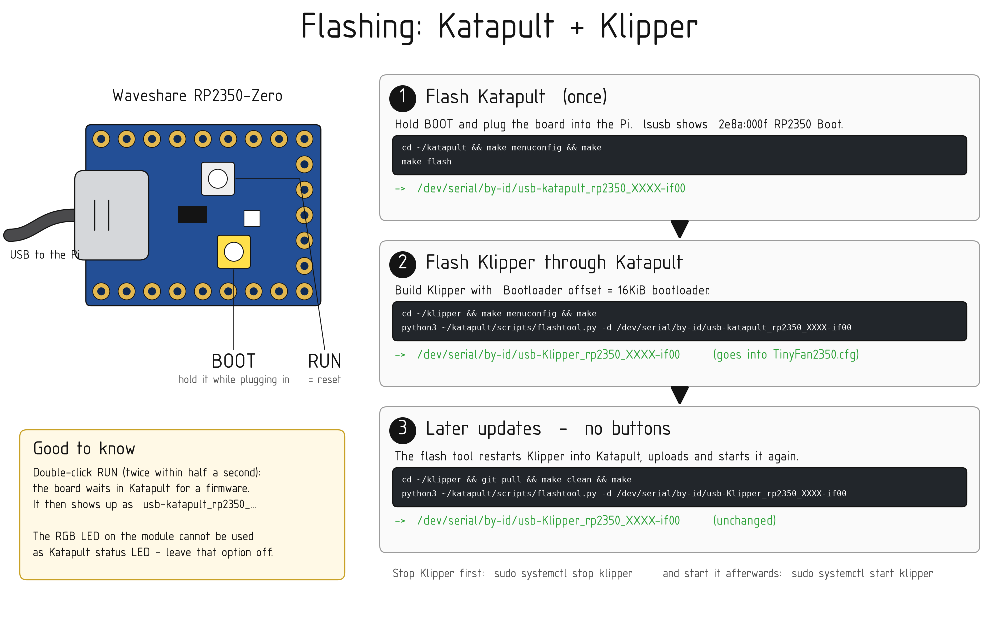
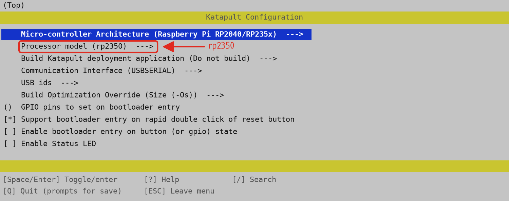
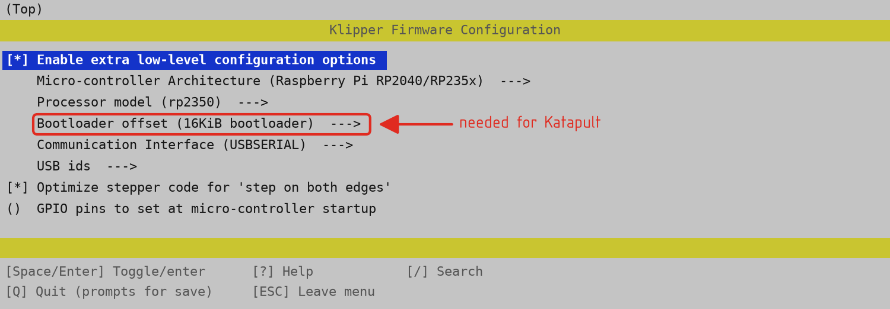
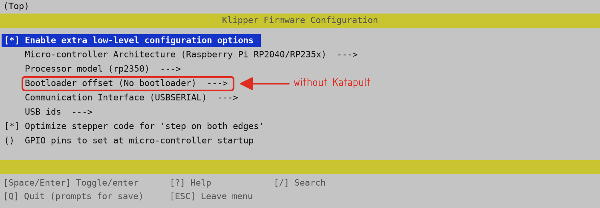

### DIN rail mount
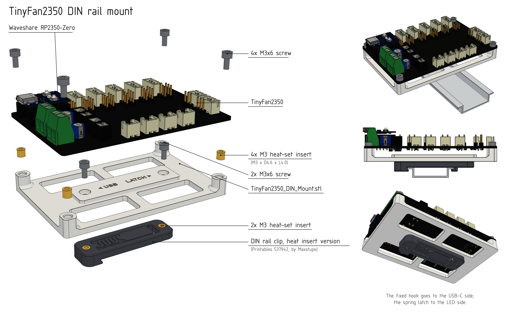
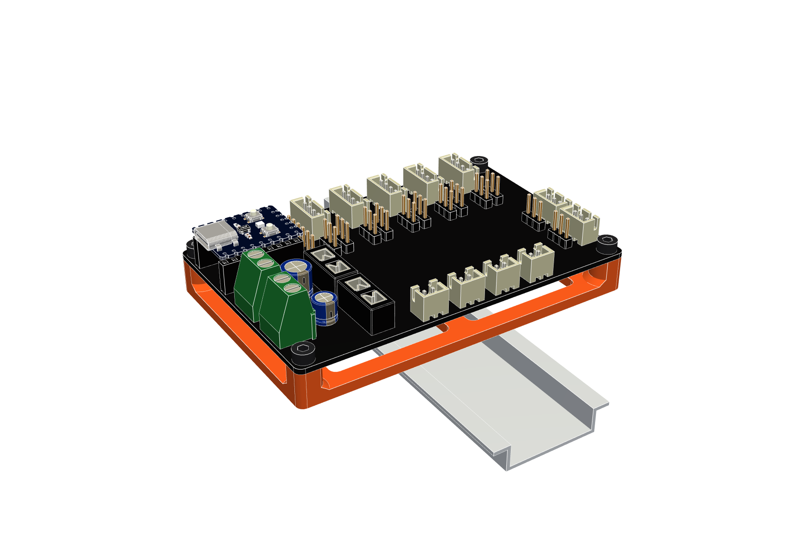

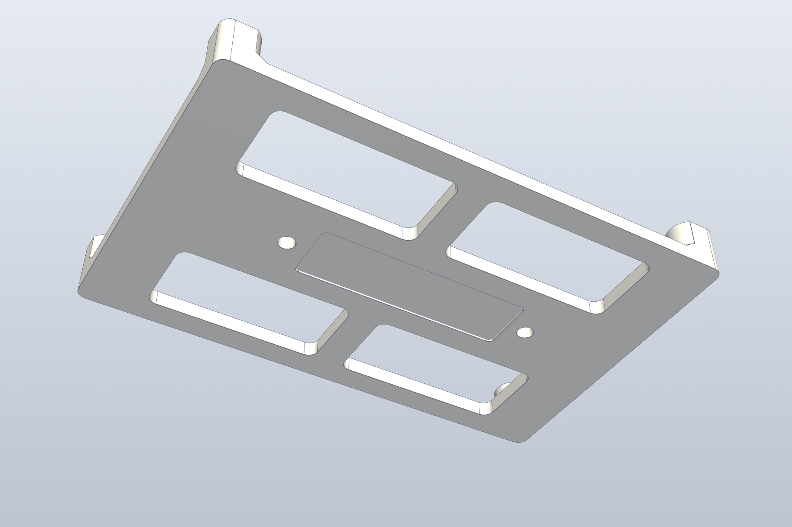
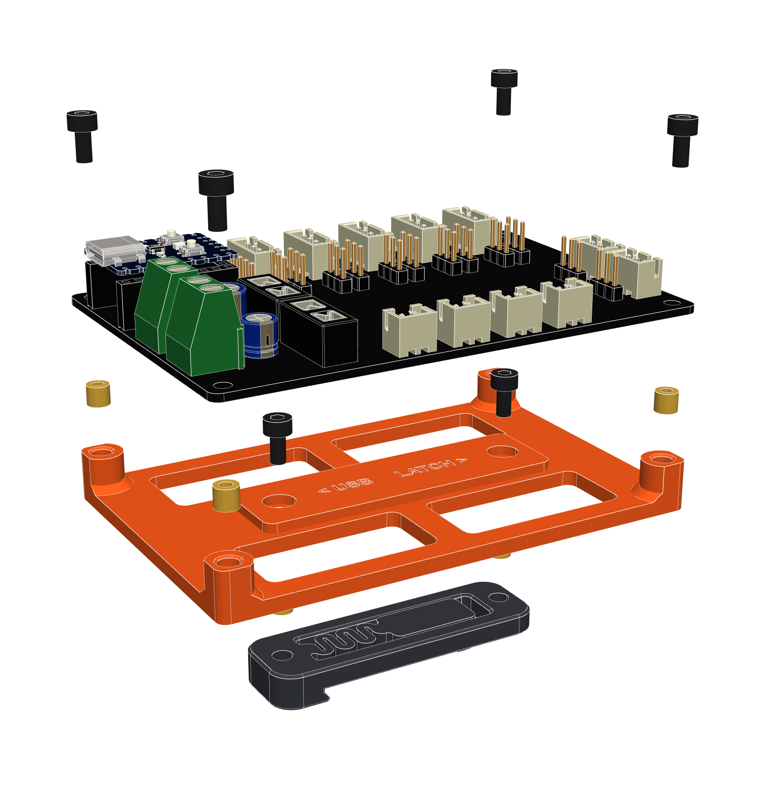
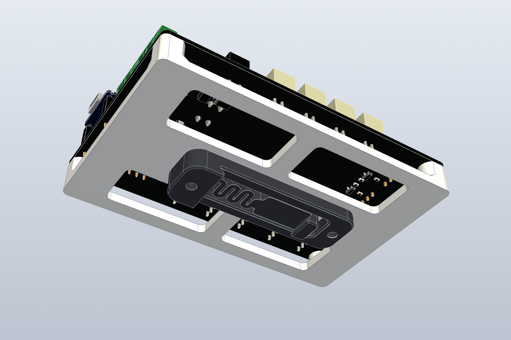
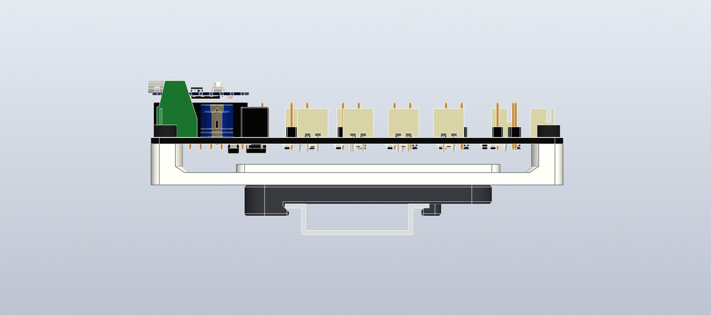

### How the drawings are made
The pinout, jumper, wiring, flashing and menuconfig pictures are drawn by the scripts in [`src`](./src), in the style of
the original [TinyFan](https://github.com/Gi7mo/TinyFan) pictures. The menuconfig pictures are drawings of the screens,
not screenshots.

After a board change:
1. `dump_layout.py` (run with KiCad's Python) reads the board and writes `layout.json`.
2. `make_illustrations.py` (Python with matplotlib) redraws the pictures.

The lettering is [osifont](https://github.com/hikikomori82/osifont) (LGPL v3 with font exception).
