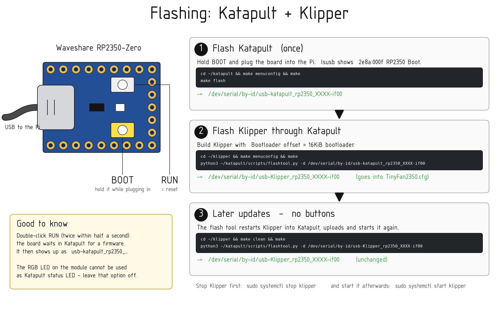
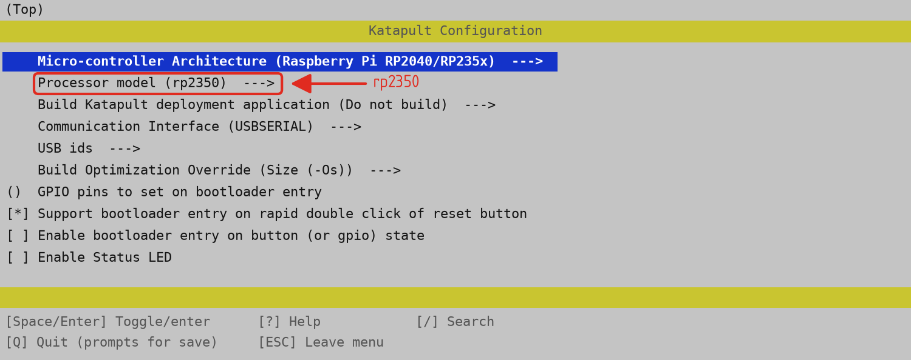
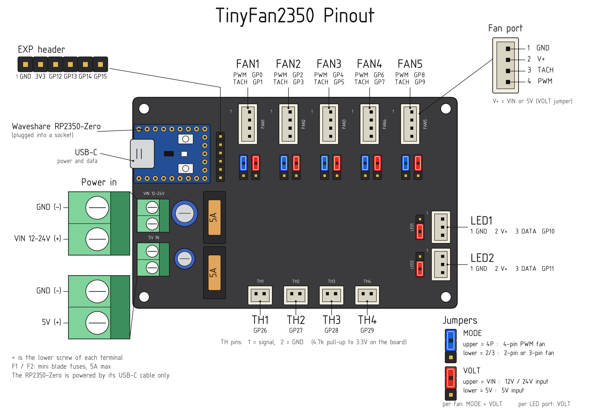

# Set it up

1. [Flash the RP2350-Zero](#1-flash-the-rp2350-zero)
2. [Set the jumpers](#2-set-the-jumpers)
3. [Wire it](#3-wire-it)
4. [Klipper config](#4-klipper-config)
5. [Ports in Klipper](#5-ports-in-klipper)
6. [Pinout](#6-pinout)
7. [Notes](#7-notes)

## 1. Flash the RP2350-Zero

[Katapult](https://github.com/Arksine/katapult) is a small bootloader that stays on the RP2350. With it, Klipper is
flashed and updated over USB without pressing a button again. You need the BOOT button only once, to put Katapult on the board.



### With Katapult (recommended)

**Flash Katapult (once)**

1. On the Pi, get Katapult and the serial library its flash tool needs:
   ```
   cd ~
   git clone https://github.com/Arksine/katapult
   sudo apt update
   sudo apt install python3-serial
   ```
2. `cd ~/katapult && make menuconfig`, set it up like this, then `make clean && make`:

   

   Leave the status LED off: the LED on the RP2350-Zero is an addressable RGB LED, which Katapult cannot drive.
3. Hold **BOOT** on the RP2350-Zero while plugging it into the Pi (or hold BOOT and tap RUN, the reset button).
   `lsusb` must show `2e8a:000f Raspberry Pi RP2350 Boot`.
4. `make flash` (alternative: copy `~/katapult/out/katapult.uf2` onto the `RP2350` USB drive that appears).
5. `ls /dev/serial/by-id/*` must now show `usb-katapult_rp2350_XXXX-if00`.
   If it does not, press **RUN** twice quickly.

**Flash Klipper through Katapult**

1. `sudo systemctl stop klipper`
2. `cd ~/klipper && make clean`. Build from the Klipper that is installed on the Pi; it has to be from 2025 or newer
   to know the RP2350. If yours is older, update Klipper the way you normally do, which also means reflashing your
   other boards, instead of pulling a newer version just for this one.
3. `make menuconfig`, set it up like this, then `make`:

   

   The **Bootloader offset** must be `16KiB bootloader`, otherwise Klipper does not start behind Katapult.
4. Flash it, using the katapult address from above:
   ```
   python3 ~/katapult/scripts/flashtool.py -d /dev/serial/by-id/usb-katapult_rp2350_XXXX-if00 -f ~/klipper/out/klipper.bin
   ```
5. `ls /dev/serial/by-id/*` now shows `usb-Klipper_rp2350_XXXX-if00`. Put that into `TinyFan2350.cfg`.
6. `sudo systemctl start klipper`

**Later updates (no buttons)**

After you have updated Klipper on the Pi, rebuild and flash this board like your other ones:
```
sudo systemctl stop klipper
cd ~/klipper && make clean && make
python3 ~/katapult/scripts/flashtool.py -d /dev/serial/by-id/usb-Klipper_rp2350_XXXX-if00 -f ~/klipper/out/klipper.bin
sudo systemctl start klipper
```
The flash tool asks Klipper to restart into Katapult, waits for it and uploads the new firmware.
`make flash FLASH_DEVICE=/dev/serial/by-id/usb-Klipper_rp2350_XXXX-if00` from the Klipper folder does the same.

**Good to know**

- **Enter Katapult by hand:** double click **RUN** (twice within half a second). The board shows up as `usb-katapult_rp2350_...` and waits for a firmware.
- **Enter Katapult from the Pi:** `python3 ~/katapult/scripts/flashtool.py -r -d /dev/serial/by-id/usb-Klipper_rp2350_XXXX-if00`
- **Klipper does not start after flashing:** it was most likely built with `No bootloader`. Double click RUN, rebuild with `16KiB bootloader` and flash again.
- **Update or remove Katapult:** hold BOOT while plugging in, then flash the new Katapult, or a Klipper built without a bootloader (below). Flashing Katapult erases Klipper, so flash Klipper again afterwards.
- **Other boards built in the same folder:** `make menuconfig` overwrites `~/klipper/.config`. If you build the firmware
  for your mainboard there too, give this board its own file by adding `KCONFIG_CONFIG=config.tinyfan` to every
  `make` command, e.g. `make menuconfig KCONFIG_CONFIG=config.tinyfan` and `make KCONFIG_CONFIG=config.tinyfan`.
- `XXXX` in the addresses stands for the serial number of your module. Copy the whole name from `ls /dev/serial/by-id/*`.
- These steps follow the Klipper and Katapult documentation. They have not been run on this board yet.

### Without a bootloader

Klipper is flashed directly with the BOOT button.

1. `sudo systemctl stop klipper`, then `cd ~/klipper && make clean`
2. `make menuconfig`, set it up like this, then `make`:

   
3. Hold **BOOT** while plugging the board into the Pi. `lsusb` must show `2e8a:000f Raspberry Pi RP2350 Boot`.
4. `make flash FLASH_DEVICE=2e8a:000f`
5. `ls /dev/serial/by-id/*` shows `usb-Klipper_rp2350_XXXX-if00`. Put that into `TinyFan2350.cfg`, then `sudo systemctl start klipper`.
6. Later updates: `make flash FLASH_DEVICE=/dev/serial/by-id/usb-Klipper_rp2350_XXXX-if00` (no button needed).

## 2. Set the jumpers

Every fan has a MODE and a VOLT jumper below its connector, every LED port has a VOLT jumper.


## 3. Wire it


- **Power:** the RP2350-Zero runs from its USB-C cable. VIN and 5V only feed the fans and LEDs, so the board works
  with one of them, both, or (for the thermistors alone) neither.
- **Fans:** every fan needs a **4-position JST-XH housing**. A 2-wire fan uses positions 1-2, a 3-wire fan 1-3; a PC fan
  plug or a smaller XH housing does not fit the shrouded header properly. In 2/3 mode pin 1 is the switched side of
  the fan, not ground: never connect it to the frame or to another ground.
- **LED strips:** the data signal needs the **5V input powered**, also when the strip itself runs from VIN.
  Keep the wire to the first LED short (about 1 m at most).
- **Switch both supplies off and unplug USB** before you plug or unplug anything.

## 4. Klipper config

Copy [TinyFan2350.cfg](./TinyFan2350.cfg) next to your `printer.cfg`, add `[include TinyFan2350.cfg]` and enter your serial address:

```
[mcu tinyfan]
serial: /dev/serial/by-id/usb-Klipper_rp2350_XXXX-if00
restart_method: command
```

The file defines the MCU, its temperature sensor, the onboard LED and a name for every pin (`FAN1_PWM`, `FAN1_RPM`, `LED1`, `TH1`, `EXP1`, ...),
plus a commented example for every port.

## 5. Ports in Klipper

Examples, one per kind of port. They are alternatives: use each pin in one section only (FAN5, for instance,
cannot be the cooling fan and a chamber fan at the same time).

**4-pin PWM fan** (MODE jumper 4P)
```
[fan_generic tinyfan_fan1]
pin: !tinyfan:FAN1_PWM
tachometer_pin: ^tinyfan:FAN1_RPM
tachometer_ppr: 2
hardware_pwm: true
cycle_time: 0.00004
off_below: 0.10
```
Every fan has its own GPIO and hardware PWM slice, so all 5 fans run at independent speeds.
If the MCU is unpowered or resetting, 4-pin fans run at full speed.

**3-pin fan** (MODE jumper 2/3)
```
[fan_generic tinyfan_fan2]
pin: tinyfan:FAN2_PWM
tachometer_pin: ^tinyfan:FAN2_RPM
tachometer_ppr: 2
hardware_pwm: true
cycle_time: 0.01
kick_start_time: 0.5
off_below: 0.20
```
The fan GND is switched, so the RPM reading is only valid at 100% speed.
Not every fan's tach output pulls low enough for the RP2350 through the board's protection diode. If the RPM reads
0 or jumps around, that fan cannot be read here; it still runs normally.

**2-pin fan** (MODE jumper 2/3)
```
[fan_generic tinyfan_fan3]
pin: tinyfan:FAN3_PWM
hardware_pwm: true
cycle_time: 0.01
kick_start_time: 0.5
off_below: 0.20
```

**Cooling fan for the board itself** (40 mm fan on the [fan bridge](../Mount#fan-bridge-optional))

The simple and safe way needs no config at all: plug a 2- or 3-pin fan into any fan port and set that port's MODE
jumper to **4P**. The fan then runs whenever its supply is on, whatever the MCU and Klipper are doing.
That port counts as one of the five, and its current counts towards the fuse.

If you would rather have it switched (2-pin fan on FAN5, MODE jumper 2/3):
```
[temperature_fan tinyfan_cooling]
pin: tinyfan:FAN5_PWM
sensor_type: temperature_mcu
sensor_mcu: tinyfan
min_temp: 0
max_temp: 100
target_temp: 45
control: watermark
```
The fan starts when the RP2350 reads more than 47 °C and stops below 43 °C. Mind what this does not do: the RP2350's
own temperature says little about the fuses and connectors, and the fan stops whenever the MCU resets or Klipper is
not running. The MCU temperature can only be read by one section: delete `[temperature_sensor TinyFan2350]` from
`TinyFan2350.cfg` when you use this.

**Addressable LED strip** (LED1 / LED2)
```
[neopixel tinyfan_led1]
pin: tinyfan:LED1
chain_count: 20
color_order: GRB
```
`chain_count` is the number of LEDs on that port. The 5V input has to be on for the data signal, see [Wire it](#3-wire-it).

**Thermistor** (TH1 - TH4)
```
[temperature_sensor chamber]
sensor_type: Generic 3950
sensor_pin: tinyfan:TH1
pullup_resistor: 4700
min_temp: -10
max_temp: 100
```

**EXP header** (GND, 3V3, GP12 - GP15, 3.3V logic only)
```
[gcode_button tinyfan_button]
pin: ^!tinyfan:EXP1
press_gcode:
    M117 button pressed
```

## 6. Pinout



## 7. Notes

- **RP2350 A2 errata (E9):** early RP2350 chips (marked `A2`) have a GPIO input leakage bug. The fan gates have 4.7k pull-downs and the tacho inputs use pull-ups, so they are fine. Check that the thermistors read room temperature correctly; modules with `A4` chips are not affected.
- **Fail-safe behaviour:** without a running MCU (USB unplugged, reset, Klipper stopped), 2/3-mode fans are OFF and
  4P-mode fans are at FULL speed. Use 4P for anything that must keep cooling.
- **Fuses:** mini blade (ATM) fuses, 5A max each. Load a fuse to 75% of its rating at most, so 3.75A per input at the very
  most (5 x 0.6A fans = 3A -> 4A fuse).
- **LED ports:** 3A is the limit of one connector; all 5V loads together have to fit the 5V fuse. 20 LEDs at full white
  take about 1.2A (RGB) or 1.6A (RGBW).
- **Cooling:** in a warm electronics bay, or with the ports loaded close to their limits, fit a 40 mm fan on the
  [fan bridge](../Mount#fan-bridge-optional). Klipper's temperature readings do not protect the board: a thermistor or
  the MCU temperature can switch a fan, but neither watches the fuses or connectors.
- **Thermistor inputs** are not protected against overvoltage: keep their wires away from 12/24V wiring.
- More in [Limits and safety](../Production#limits-and-safety).
