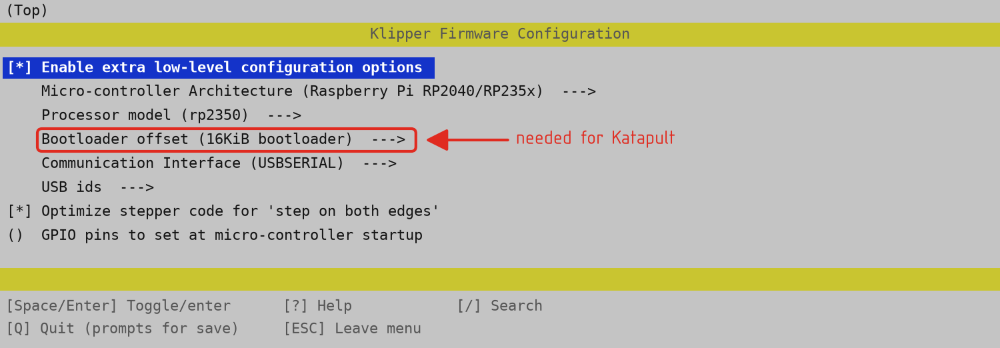

# Set it up

1. [Flash the RP2350-Zero](#1-flash-the-rp2350-zero)
2. [Set the jumpers](#2-set-the-jumpers)
3. [Wire it](#3-wire-it)
4. [Klipper config](#4-klipper-config)
5. [Ports in Klipper](#5-ports-in-klipper)
6. [Pinout](#6-pinout)
7. [Notes](#7-notes)

## 1. Flash the RP2350-Zero

[Katapult](https://github.com/Arksine/katapult) is a small bootloader that stays on the RP2350. With it, Klipper is
flashed and updated over USB without pressing a button again. You need the BOOT button only once, to put Katapult on the board.


### With Katapult (recommended)

**Flash Katapult (once)**

1. On the Pi, get Katapult and the serial library its flash tool needs:
   ```
   cd ~
   git clone https://github.com/Arksine/katapult
   sudo apt update
   sudo apt install python3-serial
   ```
2. `cd ~/katapult && make menuconfig`, set it up like this, then `make clean && make`:

   

   Leave the status LED off: the LED on the RP2350-Zero is an addressable RGB LED, which Katapult cannot drive.
3. Hold **BOOT** on the RP2350-Zero while plugging it into the Pi (or hold BOOT and tap RUN, the reset button).
   `lsusb` must show `2e8a:000f Raspberry Pi RP2350 Boot`.
4. `make flash` (alternative: copy `~/katapult/out/katapult.uf2` onto the `RP2350` USB drive that appears).
5. `ls /dev/serial/by-id/*` must now show `usb-katapult_rp2350_XXXXXXXXXXXX-if00`.
   If it does not, press **RUN** twice quickly.

**Flash Klipper through Katapult**

1. `sudo systemctl stop klipper`
2. `cd ~/klipper && git pull && make clean` (Klipper from 2025 or newer supports the RP2350)
3. `make menuconfig`, set it up like this, then `make`:

   

   The **Bootloader offset** must be `16KiB bootloader`, otherwise Klipper does not start behind Katapult.
4. Flash it, using the katapult address from above:
   ```
   python3 ~/katapult/scripts/flashtool.py -d /dev/serial/by-id/usb-katapult_rp2350_XXXX-if00 -f ~/klipper/out/klipper.bin
   ```
5. `ls /dev/serial/by-id/*` now shows `usb-Klipper_rp2350_XXXX-if00`. Put that into `TinyFan2350.cfg`.
6. `sudo systemctl start klipper`

**Later updates (no buttons)**

```
sudo systemctl stop klipper
cd ~/klipper && git pull && make clean && make
python3 ~/katapult/scripts/flashtool.py -d /dev/serial/by-id/usb-Klipper_rp2350_XXXX-if00 -f ~/klipper/out/klipper.bin
sudo systemctl start klipper
```
The flash tool asks Klipper to restart into Katapult, waits for it and uploads the new firmware.
`make flash FLASH_DEVICE=/dev/serial/by-id/usb-Klipper_rp2350_XXXX-if00` from the Klipper folder does the same.

**Good to know**

- **Enter Katapult by hand:** double click **RUN** (twice within half a second). The board shows up as `usb-katapult_rp2350_...` and waits for a firmware.
- **Enter Katapult from the Pi:** `python3 ~/katapult/scripts/flashtool.py -r -d /dev/serial/by-id/usb-Klipper_rp2350_XXXX-if00`
- **Klipper does not start after flashing:** it was most likely built with `No bootloader`. Double click RUN, rebuild with `16KiB bootloader` and flash again.
- **Update or remove Katapult:** hold BOOT while plugging in, then flash the new Katapult, or a Klipper built without a bootloader (below). Flashing Katapult erases Klipper, so flash Klipper again afterwards.

### Without a bootloader

Klipper is flashed directly with the BOOT button.

1. `sudo systemctl stop klipper`, then `cd ~/klipper && git pull && make clean`
2. `make menuconfig`, set it up like this, then `make`:

   
3. Hold **BOOT** while plugging the board into the Pi. `lsusb` must show `2e8a:000f Raspberry Pi RP2350 Boot`.
4. `make flash FLASH_DEVICE=2e8a:000f`
5. `ls /dev/serial/by-id/*` shows `usb-Klipper_rp2350_XXXX-if00`. Put that into `TinyFan2350.cfg`, then `sudo systemctl start klipper`.
6. Later updates: `make flash FLASH_DEVICE=/dev/serial/by-id/usb-Klipper_rp2350_XXXX-if00` (no button needed).

## 2. Set the jumpers

Every fan has a MODE and a VOLT jumper below its connector, every LED port has a VOLT jumper.


## 3. Wire it


## 4. Klipper config

Copy [TinyFan2350.cfg](./TinyFan2350.cfg) next to your `printer.cfg`, add `[include TinyFan2350.cfg]` and enter your serial address:

```
[mcu tinyfan]
serial: /dev/serial/by-id/usb-Klipper_rp2350_XXXX-if00
restart_method: command
```

The file defines the MCU, its temperature sensor, the onboard LED and a name for every pin (`FAN1_PWM`, `FAN1_RPM`, `LED1`, `TH1`, `EXP1`, ...),
plus a commented example for every port.

## 5. Ports in Klipper

**4-pin PWM fan** (MODE jumper 4P)
```
[fan_generic tinyfan_fan1]
pin: !tinyfan:FAN1_PWM
tachometer_pin: ^tinyfan:FAN1_RPM
tachometer_ppr: 2
hardware_pwm: true
cycle_time: 0.00004
off_below: 0.10
```
Every fan has its own GPIO and hardware PWM slice, so all 5 fans run at independent speeds.
If the MCU is unpowered or resetting, 4-pin fans run at full speed.

**3-pin fan** (MODE jumper 2/3)
```
[fan_generic tinyfan_fan2]
pin: tinyfan:FAN2_PWM
tachometer_pin: ^tinyfan:FAN2_RPM
tachometer_ppr: 2
hardware_pwm: true
cycle_time: 0.01
kick_start_time: 0.5
off_below: 0.20
```
The fan GND is switched, so the RPM reading is only valid at 100% speed.

**2-pin fan** (MODE jumper 2/3)
```
[fan_generic tinyfan_fan3]
pin: tinyfan:FAN3_PWM
hardware_pwm: true
cycle_time: 0.01
kick_start_time: 0.5
off_below: 0.20
```

**Addressable LED strip** (LED1 / LED2)
```
[neopixel tinyfan_led1]
pin: tinyfan:LED1
chain_count: 30
color_order: GRB
```

**Thermistor** (TH1 - TH4)
```
[temperature_sensor chamber]
sensor_type: Generic 3950
sensor_pin: tinyfan:TH1
pullup_resistor: 4700
min_temp: -10
max_temp: 100
```

**EXP header** (GND, 3V3, GP12 - GP15, 3.3V logic only)
```
[gcode_button tinyfan_button]
pin: ^!tinyfan:EXP1
press_gcode:
    M117 button pressed
```

## 6. Pinout


## 7. Notes

- **RP2350 A2 errata (E9):** early RP2350 chips (marked `A2`) have a GPIO input leakage bug. The fan gates have 4.7k pull-downs and the tacho inputs use pull-ups, so they are fine. Check that the thermistors read room temperature correctly; modules with `A4` chips are not affected.
- **Fail-safe behaviour:** without a running MCU, 2/3-mode fans are OFF and 4P-mode fans are at FULL speed. Use 4P fans for anything that must keep cooling.
- **Fuses:** mini blade (ATM) fuses, 5A max each. Use the smallest fuse that covers your load (5 x 0.6A fans = 3A -> 3A or 4A fuse).
- **Thermistor inputs** are not protected against overvoltage: keep their wires away from 12/24V wiring.
