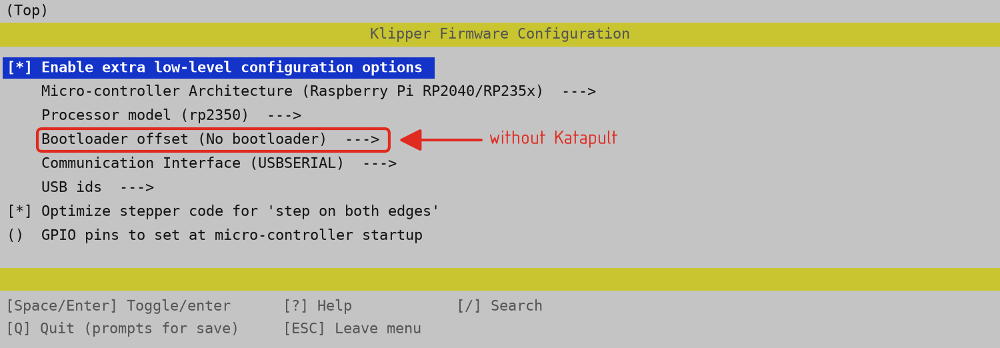
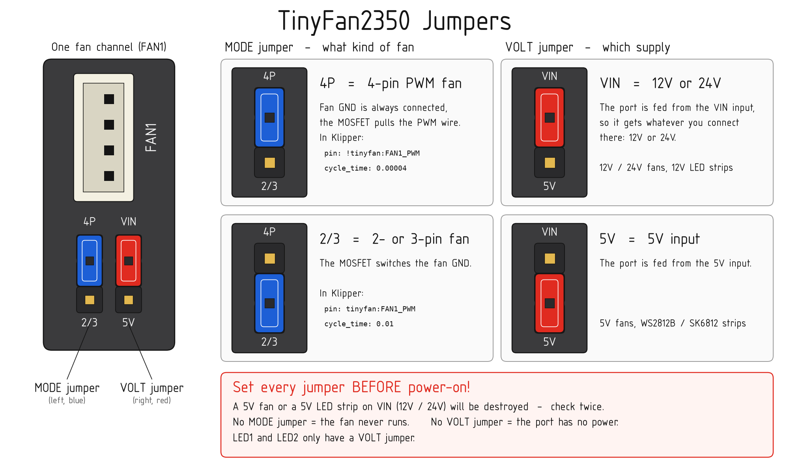
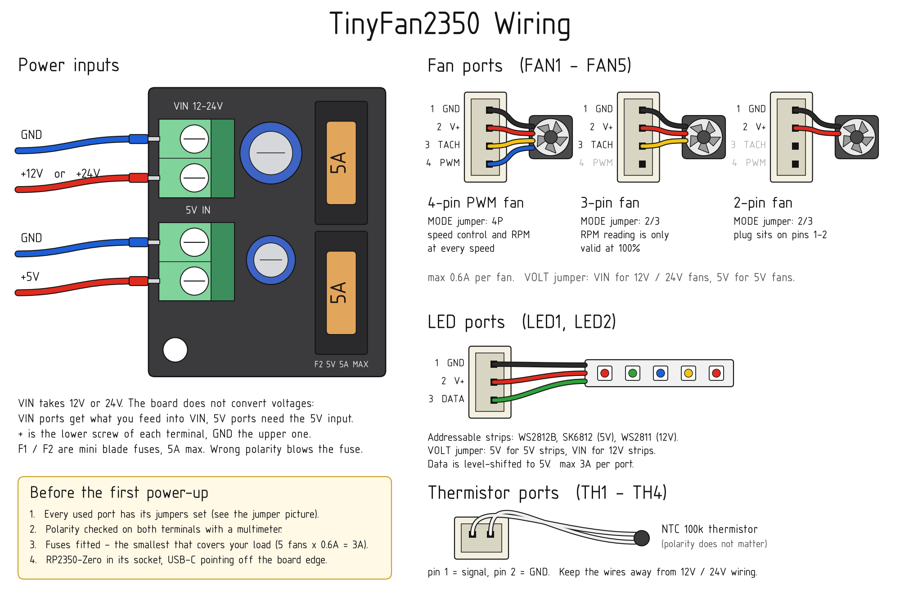

## Klipper:
 

<ul><li>

<h3><a href="./TinyFan2350.cfg">TinyFan2350 Example Config</a></h3>

Base config with <code>[mcu tinyfan]</code>, the MCU temperature sensor, the onboard LED and all pin aliases, plus commented examples for every port. 
Copy it next to your <code>printer.cfg</code> and add <code>[include TinyFan2350.cfg]</code>.

</li></ul>

<ul><li>

<h3>Board Aliases:</h3>

<pre>[mcu tinyfan]
serial: /dev/serial/by-id/usb-Klipper_rp2350_XXXXXXXXXXXX
restart_method: command

[board_pins tinyfan]
mcu: tinyfan
aliases:
    #FAN Ports:
    FAN1_PWM=gpio0, FAN1_RPM=gpio1,
    FAN2_PWM=gpio2, FAN2_RPM=gpio3,
    FAN3_PWM=gpio4, FAN3_RPM=gpio5,
    FAN4_PWM=gpio6, FAN4_RPM=gpio7,
    FAN5_PWM=gpio8, FAN5_RPM=gpio9,

    #LED Ports:
    LED1=gpio10, LED2=gpio11,

    #Thermistor Ports:
    TH1=gpio26, TH2=gpio27, TH3=gpio28, TH4=gpio29,

    #EXP Header:
    EXP1=gpio12, EXP2=gpio13, EXP3=gpio14, EXP4=gpio15,

    #Waveshare LED:
    ONBOARD_LED=gpio16</pre>

</li></ul>

<ul><li>

 
<h3>Installation with Katapult (recommended):</h3>

 <a href="https://github.com/Arksine/katapult">Katapult</a> is a small bootloader that stays on the RP2350. With it, Klipper can be flashed and updated over USB without ever pressing the BOOT button again. 
 You only need the BOOT button once, to put Katapult on the board.
 

 <h4>1. Flash Katapult (once)</h4>
 <li>ssh into your raspberry pi</li>
 <li>get Katapult and the serial library its flash tool needs</li>
 <pre>cd ~
git clone https://github.com/Arksine/katapult
sudo apt update
sudo apt install python3-serial</pre>
 <li>create the build config <code>cd ~/katapult && make menuconfig</code> using the following settings</li>
 <pre>    Micro-controller Architecture (Raspberry Pi RP2040/RP235x)
    Processor model (rp2350)
    Build Katapult deployment application (Do not build)
    Communication Interface (USBSERIAL)
    USB ids  ---&gt;  (leave default)
    Build Optimization Override (Size (-Os))
()  GPIO pins to set on bootloader entry
[*] Support bootloader entry on rapid double click of reset button
[ ] Enable bootloader entry on button (or gpio) state
[ ] Enable Status LED</pre>
 

 <li>leave the status LED off: the LED on the RP2350-Zero is an addressable RGB LED (GP16), which Katapult cannot drive</li>
 <li>run the build <code>make clean && make</code></li>
 <li>hold the <b>BOOT</b> button on the RP2350-Zero while plugging it into the Pi (or hold BOOT and tap RUN, the reset button)</li>
 <li>check that it shows up with <code>lsusb</code> as <code>2e8a:000f Raspberry Pi RP2350 Boot</code></li>
 <li>flash it <code>make flash</code> 
 (alternative: copy <code>~/katapult/out/katapult.uf2</code> onto the <code>RP2350</code> USB drive that appears)</li>
 <li>the board restarts into Katapult. Check with <code>ls /dev/serial/by-id/*</code>, it must show</li>
 <pre>/dev/serial/by-id/usb-katapult_rp2350_XXXXXXXXXXXX-if00</pre>
 <li>if it does not show up, quickly press <b>RUN</b> (the reset button) twice to force the bootloader</li>

 <h4>2. Flash Klipper through Katapult</h4>
 <li>stop the klipper service <code>sudo systemctl stop klipper</code></li>
 <li>make sure your Klipper is recent enough to support the RP2350 (2025 or newer): <code>cd ~/klipper && git pull</code></li>
 <li>cleanup all previous build files <code>make clean</code></li>
 <li>create a new build config <code>make menuconfig</code> using the following settings</li>
 <pre>[*] Enable extra low-level configuration options
    Micro-controller Architecture (Raspberry Pi RP2040/RP235x)
    Processor model (rp2350)
    Bootloader offset (16KiB bootloader)
    Communication Interface (USBSERIAL)
    USB ids  ---&gt;  (leave default)
[*] Optimize stepper code for 'step on both edges'
()  GPIO pins to set at micro-controller startup</pre>
 

 <li>the <b>Bootloader offset</b> must be <code>16KiB bootloader</code>, otherwise Klipper will not start behind Katapult</li>
 <li>run the build <code>make</code> (this creates <code>~/klipper/out/klipper.bin</code>)</li>
 <li>flash it through Katapult, using the katapult address from above</li>
 <pre>python3 ~/katapult/scripts/flashtool.py -d /dev/serial/by-id/usb-katapult_rp2350_XXXX-if00 -f ~/klipper/out/klipper.bin</pre>
 <li>find your mcu address by running <code>ls /dev/serial/by-id/*</code> (it now starts with <code>usb-Klipper_rp2350_</code>)</li>
 <li>put it into <code>TinyFan2350.cfg</code></li>
 <pre>[mcu tinyfan]
serial: /dev/serial/by-id/usb-Klipper_rp2350_XXXX-if00</pre>
 <li>start the klipper service <code>sudo systemctl start klipper</code></li>

 <h4>3. Later Klipper updates (no buttons needed)</h4>
 <li><code>sudo systemctl stop klipper</code></li>
 <li><code>cd ~/klipper && git pull && make clean && make</code> (the menuconfig settings are kept)</li>
 <li>flash using the <b>Klipper</b> address. The flash tool asks Klipper to restart into Katapult, waits for it and uploads the new firmware</li>
 <pre>python3 ~/katapult/scripts/flashtool.py -d /dev/serial/by-id/usb-Klipper_rp2350_XXXX-if00 -f ~/klipper/out/klipper.bin</pre>
 <li>or do the same from the Klipper folder: <code>make flash FLASH_DEVICE=/dev/serial/by-id/usb-Klipper_rp2350_XXXX-if00</code></li>
 <li><code>sudo systemctl start klipper</code></li>

 <h4>Good to know</h4>
 <li><b>Enter Katapult by hand:</b> double click <b>RUN</b> (the reset button) on the RP2350-Zero, twice within half a second. The board then shows up as <code>usb-katapult_rp2350_...</code> and waits for a firmware upload.</li>
 <li><b>Enter Katapult from the Pi:</b> <code>python3 ~/katapult/scripts/flashtool.py -r -d /dev/serial/by-id/usb-Klipper_rp2350_XXXX-if00</code></li>
 <li><b>Klipper does not start after flashing:</b> it was most likely built with <code>No bootloader</code>. Double click RUN, rebuild with <code>16KiB bootloader</code> and flash again.</li>
 <li><b>Update or remove Katapult:</b> hold BOOT while plugging in, then flash the new Katapult (step 1) or a Klipper built with <code>No bootloader</code> (next section). Flashing Katapult again erases Klipper, so repeat step 2 afterwards.</li>

</li></ul>

<ul><li>

 
<h3>Installation without a bootloader:</h3>

 Use this if you do not want Katapult. Klipper is then flashed directly with the BOOT button.
 <li>ssh into your raspberry pi</li>
 <li>stop the klipper service <code>sudo systemctl stop klipper</code></li>
 <li>make sure your Klipper is recent enough to support the RP2350 (2025 or newer): <code>cd ~/klipper && git pull</code></li>
 <li>cleanup all previous build files <code>make clean</code></li>
 <li>create a new build config <code>make menuconfig</code> using the following settings</li>
 <pre>[*] Enable extra low-level configuration options
    Micro-controller Architecture (Raspberry Pi RP2040/RP235x)
    Processor model (rp2350)
    Bootloader offset (No bootloader)
    Communication Interface (USBSERIAL)
    USB ids  ---&gt;  (leave default)
[*] Optimize stepper code for 'step on both edges'
()  GPIO pins to set at micro-controller startup</pre>
 

 <li>run the build <code>make</code></li>
 <li>hold the <b>BOOT</b> button on the RP2350-Zero while plugging it into the Pi (or hold BOOT and tap RUN, the reset button)</li>
 <li>check that it shows up with <code>lsusb</code> as <code>2e8a:000f Raspberry Pi RP2350 Boot</code></li>
 <li>flash it <code>make flash FLASH_DEVICE=2e8a:000f</code></li>
 <li>find your mcu address by running <code>ls /dev/serial/by-id/*</code></li>
 <li>put it into <code>TinyFan2350.cfg</code></li>
 <pre>[mcu tinyfan]
serial: /dev/serial/by-id/usb-Klipper_rp2350_XXXX</pre>
 <li>start the klipper service <code>sudo systemctl start klipper</code></li>
 <li>later updates: <code>make flash FLASH_DEVICE=/dev/serial/by-id/usb-Klipper_rp2350_XXXX</code> (no BOOT button needed)</li>

</li></ul>

<ul><li>

 
<h3>Jumpers (set them BEFORE power-on):</h3>

Every fan has two 3-pin jumpers below its connector, every LED port has one.

|Jumper|Position|Meaning|
|---|---|---|
|Fan **mode** (left, `4P` / `2/3`)|upper 2 pins = **4P**|4-pin PWM fan. Fan GND is solid, the PWM wire is pulled by the MOSFET. Klipper pin **inverted** (`!`), `cycle_time: 0.00004`|
| |lower 2 pins = **2/3**|2- or 3-pin fan. The MOSFET switches the fan GND. Klipper pin **not** inverted, `cycle_time: 0.01`|
|Fan **volt** (right, `VIN` / `5V`)|upper 2 pins = **VIN**|fan gets the 12V/24V input|
| |lower 2 pins = **5V**|fan gets the 5V input|
|LED **volt** (`VIN` / `5V`)|upper 2 pins = **VIN**|strip gets 12V/24V (e.g. WS2811 12V)|
| |lower 2 pins = **5V**|strip gets 5V (WS2812B / SK6812)|

- A missing mode jumper = fan never runs. A missing volt jumper = port unpowered.
- A 5V fan or 5V LED strip on **VIN** will be destroyed - double check!

</li></ul>

<ul><li>

 
<h3>Outputs and Options:</h3>

 

 

  
<h4>Fan1 - Fan5: 4-pin PWM fans with RPM (mode jumper 4P)</h4>

  <pre>[fan_generic tinyfan_fan1]
pin: !tinyfan:FAN1_PWM
tachometer_pin: ^tinyfan:FAN1_RPM
tachometer_ppr: 2
hardware_pwm: true
cycle_time: 0.00004
off_below: 0.10</pre>
 • every fan has its own GPIO and its own hardware PWM slice, so all 5 fans run at independent speeds (and even different cycle_times) 
 • if the MCU is unpowered or resetting, 4-pin fans run at full speed (the fan pulls its own PWM wire high)
 

 

  
<h4>Fan1 - Fan5: 3-pin fans with RPM (mode jumper 2/3)</h4>

  <pre>[fan_generic tinyfan_fan2]
pin: tinyfan:FAN2_PWM
tachometer_pin: ^tinyfan:FAN2_RPM
tachometer_ppr: 2
hardware_pwm: true
cycle_time: 0.01
kick_start_time: 0.5
off_below: 0.20</pre>
 • the tacho works, but because the fan GND is switched the RPM reading is only valid at 100% speed 
 • for accurate RPM at every speed use a 4-pin fan in 4P mode
 

 

  
<h4>Fan1 - Fan5: 2-pin fans (mode jumper 2/3)</h4>

  <pre>[fan_generic tinyfan_fan3]
pin: tinyfan:FAN3_PWM
hardware_pwm: true
cycle_time: 0.01
kick_start_time: 0.5
off_below: 0.20</pre>
 • 2-pin JST plugs fit into pins 1-2 (GND, +V) of the 4-pin port
 

 

  
<h4>LED1 / LED2: addressable strips (Neopixel, WS2812, SK6812, WS2811)</h4>

  <pre>[neopixel tinyfan_led1]
pin: tinyfan:LED1
chain_count: 30
color_order: GRB</pre>
 • data is level-shifted to 5V logic (2N7002 + pull-up) with a 330R series resistor 
 • max. 3A per LED port (JST-XH contact rating)
 

 

  
<h4>TH1 - TH4: thermistors</h4>

  <pre>[temperature_sensor chamber]
sensor_type: Generic 3950
sensor_pin: tinyfan:TH1
pullup_resistor: 4700
min_temp: -10
max_temp: 100</pre>
 • 4.7k pull-up to 3.3V + 100nF filter, any NTC 100k works 
 • keep thermistor wires away from 12/24V wiring - the ADC pins are not protected against overvoltage
 

 

  
<h4>EXP header</h4>

  <pre>[gcode_button tinyfan_button]
pin: ^!tinyfan:EXP1
press_gcode:
    M117 button pressed</pre>
 • pinout: GND, 3V3, GP12, GP13, GP14, GP15 - 3.3V logic only
 

</li></ul>

<ul><li>

 
<h3>Notes:</h3>

 <li><b>RP2350 A2 errata (E9):</b> early RP2350 chips (marked <code>A2</code>) have a GPIO input leakage bug. The fan gates already have 4.7k pull-downs (≤8.2k as recommended), and tacho inputs use pull-ups, so they are fine. Check that the thermistors read room temperature correctly; modules with <code>A4</code> chips are not affected.</li>
 <li><b>Fail-safe behaviour:</b> without a running MCU, 2/3-mode fans are OFF and 4P-mode fans are at FULL speed. Use 4P fans for anything that must keep cooling.</li>
 <li><b>Fuses:</b> mini blade (ATM) fuses, 5A max each. Use the smallest fuse that covers your load (e.g. 5 x 0.6A fans = 3A -> 3A or 4A fuse).</li>

</li></ul>

<ul><li>

 
<h3>Pinout (Picturized):</h3>

 

</li></ul>
