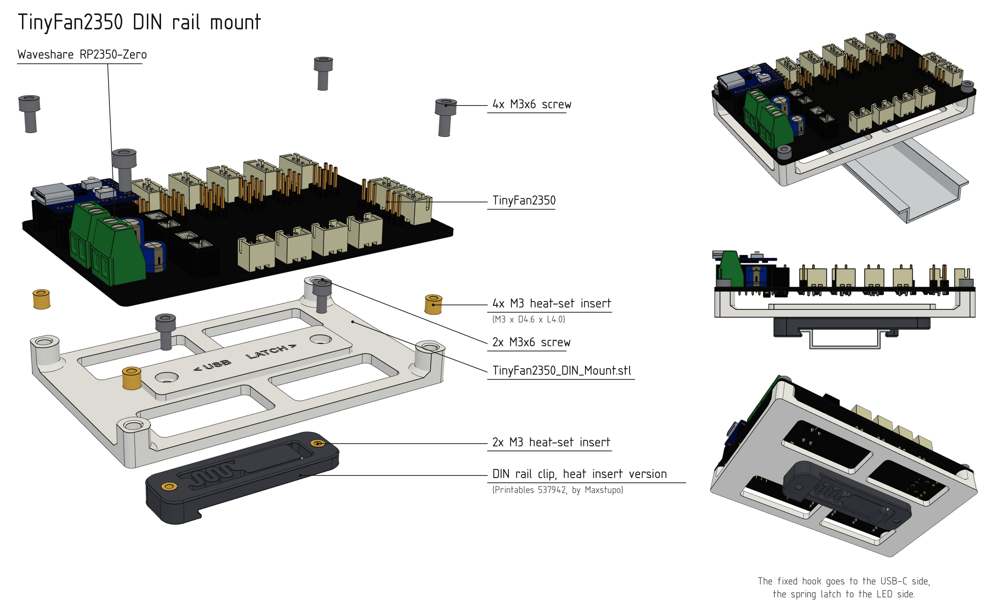
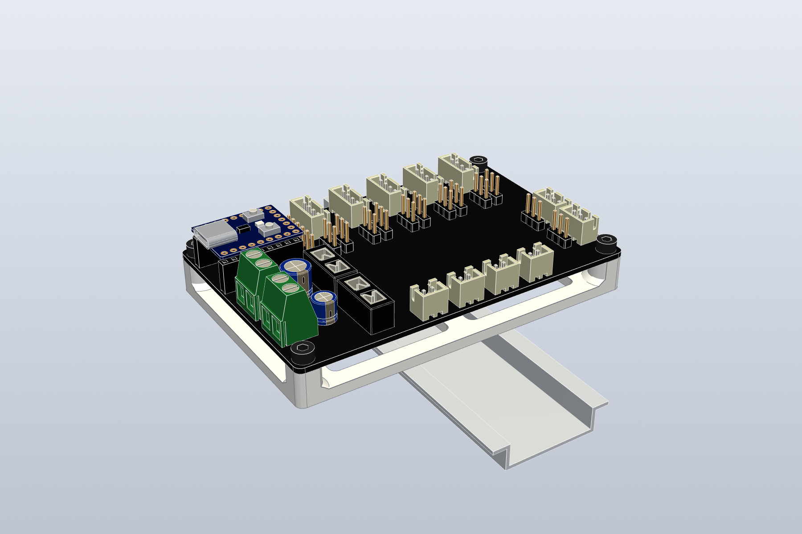
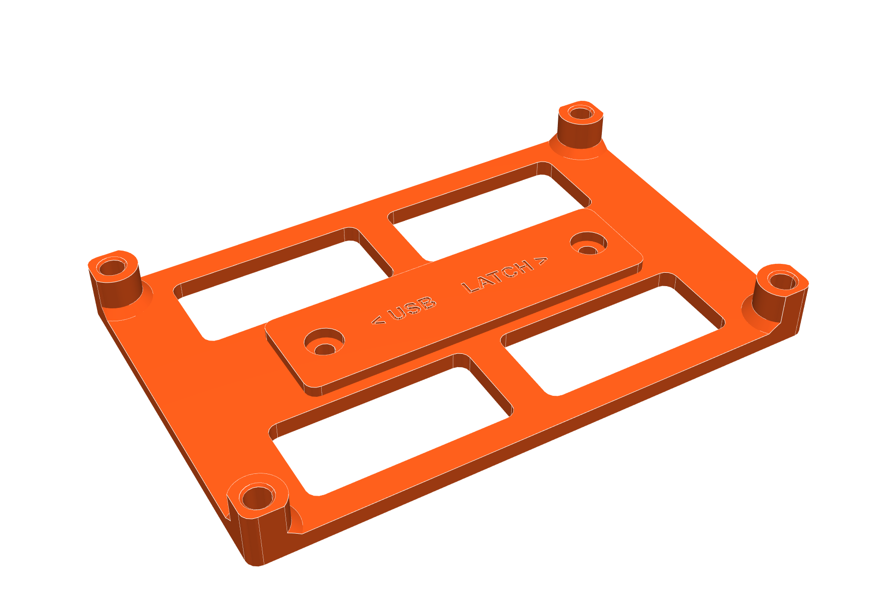

# Mount it

A 3D-printed tray that holds the TinyFan2350 on a 35 mm **DIN rail**. It uses one
[DIN Rail Clip (Heat Insert Version)](https://www.printables.com/model/537942-din-rail-clip-heat-insert-version) by Maxstupo.
The board sits **across** the rail and takes 65 mm of rail length.

## Parts

|Qty|Part|Notes|
|---|---|---|
|1|[TinyFan2350_DIN_Mount.stl](./TinyFan2350_DIN_Mount.stl)|printed|
|1|DIN Rail Clip (Heat Insert Version)|print it from [Printables 537942](https://www.printables.com/model/537942-din-rail-clip-heat-insert-version/files) (CC BY-NC-SA, not included here)|
|6|M3 heat-set insert, M3 x D4.6 x L4.0|4 in the mount, 2 in the clip|
|2|M3x6 screw, socket or button head|mount -> clip (M3x8 also fits)|
|4|M3x6 screw|PCB -> mount|

## Print
- ABS / ASA (or PETG if the electronics bay stays cool), 0.2 mm layers, 4 walls, 5 top/bottom layers, 40 % infill.
- **Flat side down**, as exported. No supports. The only bridge is a 0.4 mm deep pocket on the underside.

## Assemble

1. Press the two inserts into the **flat face** of the clip and the four inserts into the standoffs of the mount
   with a soldering iron (about 220-250 C), flush with the surface. Go gently on the standoffs: the wall is 1.4 mm on the outer sides.
2. Put the clip against the underside of the mount. The **fixed hook** goes to the side marked `< USB`,
   the **spring latch** to the side marked `LATCH >`. Screw it on from the top with 2 x M3x6.
3. Fit the PCB with 4 x M3x6, USB-C to the side marked `< USB`.
4. Hook the fixed end over one edge of the rail and press the other side down until the latch snaps in.
   On a horizontal rail the USB-C end is at the top. To remove the board, push the latch back with a flat screwdriver.

## Details
- 100 x 65 mm (the PCB outline), 10 mm high: 3 mm plate + 7 mm standoffs. The PCB underside sits 14.6 mm in front of the rail.
- The 7 mm under the PCB cover the bottom-side parts (2.4 mm) and the through-hole leads; checked against the board's 3D model, the smallest gap is 1.7 mm.
- To change anything (standoff height, insert size, clip position, label), edit the values at the top of
  [TinyFan2350_DIN_Mount.py](./TinyFan2350_DIN_Mount.py) and run it with [CadQuery](https://github.com/CadQuery/cadquery) 2.x.
  It rewrites the [STEP](./TinyFan2350_DIN_Mount.step) and the STL.
- The mount has **not been printed or test-fitted yet**.

