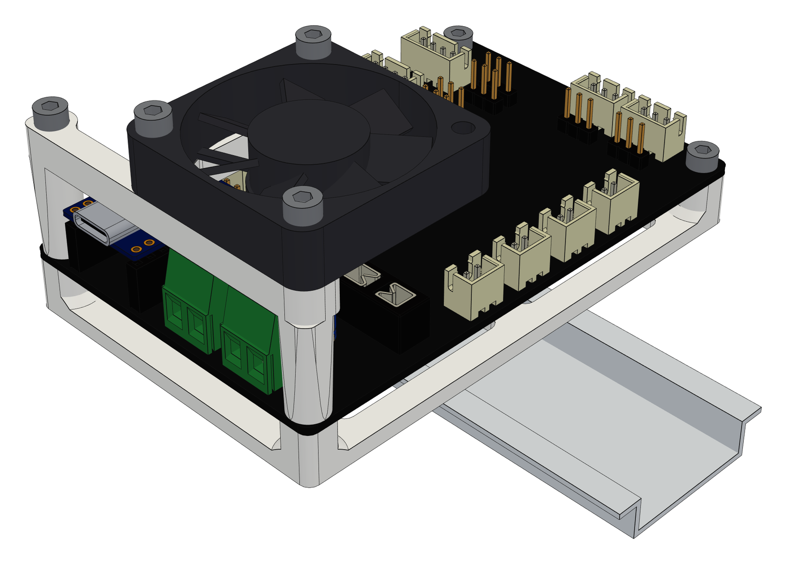
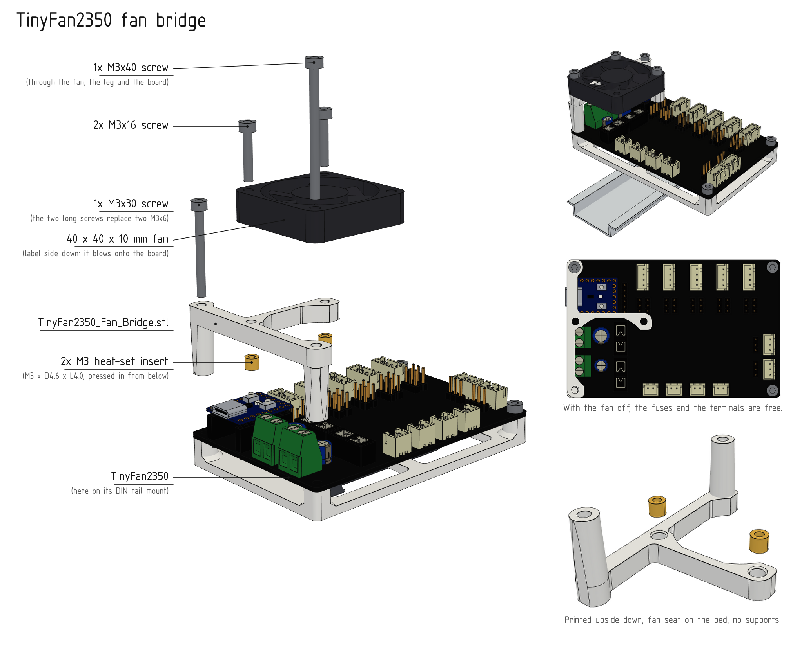

# Mount it

  
  

|[• DIN rail mount](#din-rail-mount)|[• Fan bridge](#fan-bridge-optional) (optional)|
|---|---|
|Printed tray that clips the board onto a 35 mm DIN rail (left)|Adds a 40 mm cooling fan above the fuses and power terminals (right). Fits with or without the DIN mount|

## DIN rail mount

A 3D-printed tray that holds the TinyFan2350 on a 35 mm **DIN rail**. It uses one
[DIN Rail Clip (Heat Insert Version)](https://www.printables.com/model/537942-din-rail-clip-heat-insert-version) by Maxstupo.
The board sits **across** the rail and takes 65 mm of rail length.

### Parts

|Qty|Part|Notes|
|---|---|---|
|1|[TinyFan2350_DIN_Mount.stl](./TinyFan2350_DIN_Mount.stl)|printed|
|1|DIN Rail Clip (Heat Insert Version)|print it from [Printables 537942](https://www.printables.com/model/537942-din-rail-clip-heat-insert-version/files) (CC BY-NC-SA, not included here)|
|6|M3 heat-set insert, M3 x D4.6 x L4.0|4 in the mount, 2 in the clip|
|2|M3x6 screw, socket or button head|mount -> clip (M3x8 also fits)|
|4|M3x6 screw|PCB -> mount|

### Print
- ABS / ASA (or PETG if the electronics bay stays cool), 0.2 mm layers, 4 walls, 5 top/bottom layers, 40 % infill.
- **Flat side down**, as exported. No supports. The only bridge is a 0.4 mm deep pocket on the underside.

### Assemble

1. Press the two inserts into the **flat face** of the clip and the four inserts into the standoffs of the mount
   with a soldering iron (about 220-250 C), flush with the surface. Go gently on the standoffs: the wall is 1.4 mm on the outer sides.
2. Put the clip against the underside of the mount. The **fixed hook** goes to the side marked `< USB`,
   the **spring latch** to the side marked `LATCH >`. Screw it on from the top with 2 x M3x6.
3. Fit the PCB with 4 x M3x6, USB-C to the side marked `< USB`.
4. Hook the fixed end over one edge of the rail and press the other side down until the latch snaps in.
   On a horizontal rail the USB-C end is at the top. To remove the board, push the latch back with a flat screwdriver.

### Details
- 100 x 65 mm (the PCB outline), 10 mm high: 3 mm plate + 7 mm standoffs. The PCB underside sits 14.6 mm in front of the rail.
- The 7 mm under the PCB cover the bottom-side parts (2.4 mm) and the through-hole leads; checked against the board's 3D model, the smallest gap is 1.7 mm.
- To change anything (standoff height, insert size, clip position, label), edit the values at the top of
  [TinyFan2350_DIN_Mount.py](./TinyFan2350_DIN_Mount.py) and run it with [CadQuery](https://github.com/CadQuery/cadquery) 2.x.
  It rewrites the [STEP](./TinyFan2350_DIN_Mount.step) and the STL.
- The mount has **not been printed or test-fitted yet**.

## Fan bridge (optional)

A small bridge that holds a **40 x 40 x 10 mm fan** above the power terminals, the capacitors and the fuses,
blowing down onto the board. The fan sits in the corner of the board, flush with two of its edges:
**nothing reaches past the PCB outline**. The bridge stands on the two mounting holes at the USB-C end and is
held by the screws that hold the board there, so it fits on the DIN mount and on other M3 standoffs with a
vertical thread. Worth fitting if the board sits in a warm electronics bay or runs close to its limits; how much
it lowers the temperatures has not been measured.

### Parts

|Qty|Part|Notes|
|---|---|---|
|1|[TinyFan2350_Fan_Bridge.stl](./TinyFan2350_Fan_Bridge.stl)|printed|
|1|40 x 40 x 10 mm fan|2-, 3- or 4-pin; 5V, 12V or 24V, whatever the port's VOLT jumper is set to|
|2|M3 heat-set insert, M3 x D4.6 x L4.0|in the underside of the bridge|
|2|M3x16 screw|fan -> bridge|
|1|M3x40 screw|fan, bridge and PCB -> mount, in place of an M3x6|
|1|M3x30 screw|bridge and PCB -> mount, in place of an M3x6|

### Print
- Same settings as the mount.
- **Upside down, fan seat on the bed**, as exported. No supports, no bridges.

### Assemble

Switch both supplies off and unplug USB before you start, and every time you take the fan off again.

1. Press the two inserts into the **underside** of the bridge, flush.
2. Wire both power terminals and fit the fuses now: they end up under the fan.
3. Take out the two board screws at the USB-C end and set the bridge on the board.
   Fasten the leg next to the RP2350-Zero with the M3x30.
4. Put the fan on, **label side down**, so that it blows onto the board (the arrow on the fan's side points down).
   Start all three fan screws loosely: the M3x40 through the fan's corner above the other leg, through that leg and
   the board into the mount, and the two M3x16 into the inserts.
5. The M3x40 leans by about 1 degree (see below), so thread it into the mount **by hand first**. It has to turn
   freely. If it binds, loosen the other screws and let the fan and the bridge settle; if it still binds, open the
   hole in that leg to 4 mm. Never force it: the thread it goes into is a heat-set insert in plastic.
   Then tighten all screws gently, the legs are plastic.
6. Plug the fan into any fan port and set that port's jumpers: MODE **4P** lets a 2- or 3-pin fan run whenever
   its supply is on, which is what a cooling fan should do; VOLT to the fan's voltage.
   Switched by Klipper instead: [Set it up](../Klipper#5-ports-in-klipper).

### Details
- Under the fan: both power terminals, both capacitors and both fuses. To reach them, take the fan off (3 screws);
  the bridge stays and leaves all of them open from above.
- The fan's fourth corner hangs free on purpose: the TH1 connector sits below it, and its plug still fits (7 mm of room).
  All other connectors, the jumpers, the EXP header and the BOOT / RUN buttons stay uncovered.
- The arm crosses the USB-C socket 4 mm above it; the cable plugs in underneath. To pull the RP2350-Zero out of its
  socket, take the bridge off.
- 40 x 65 x 23.9 mm, the top of the fan is 34 mm above the PCB. Checked against the board's 3D model:
  nothing outside the PCB outline, 0.9 mm to the RP2350-Zero, 4 mm above the terminal blocks.
- The fan's holes are 4 mm from its edges, the board's holes 3.5 mm. With the fan flush with the board, the M3x40
  therefore leans by about 1 degree; the hole in the leg is made for that. Whether the screw still enters the
  vertical thread below without binding depends on the fan, the print and the insert, so test it as described above.
- The clearances come from the CAD model, with a fitted fuse taken as 16.5 mm high and the USB-C plug as 8.5 mm
  thick: 3.7 mm between the VIN fuse and the bridge, 7.4 mm between the fuses and the fan, 0.8 mm between the plug
  and the arm. A thicker USB-C plug does not fit under the arm, so measure yours before you print.
- Edit the values at the top of [TinyFan2350_Fan_Bridge.py](./TinyFan2350_Fan_Bridge.py) to change it; it rewrites the
  [STEP](./TinyFan2350_Fan_Bridge.step) and the STL. `LEG_SCREW_LENGTH` sets the height; 30 is the shortest standard
  screw that keeps the deck clear of the terminal blocks.
- The bridge has **not been printed or test-fitted yet**.
