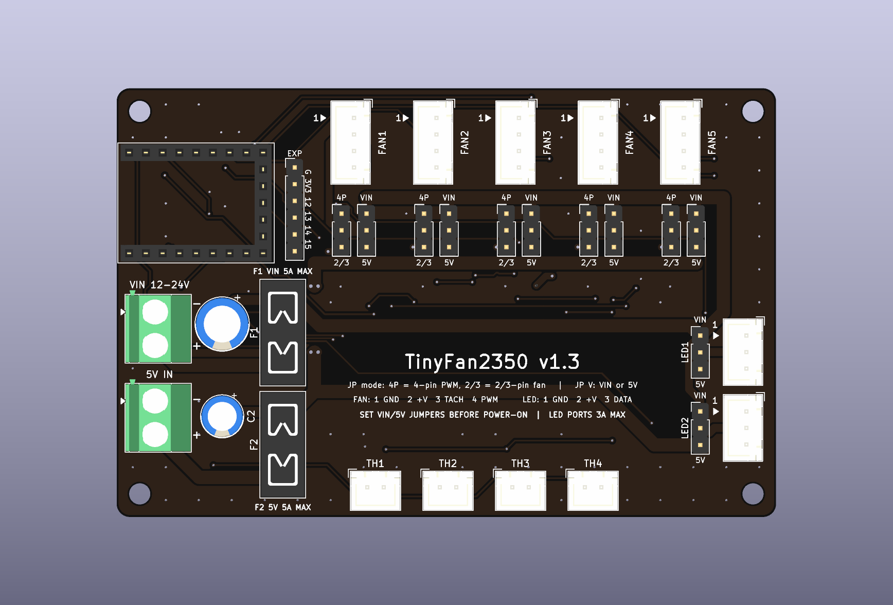

# Build it

## Order the PCB

Files in this folder:

|File|Use|
|---|---|
|[GERBER-TinyFan2350.zip](./GERBER-TinyFan2350.zip)|the PCB (Gerbers + drill)|
|[JLC-Economic-BOM-bottom.csv](./JLC-Economic-BOM-bottom.csv)|JLCPCB assembly: parts list|
|[JLC-Economic-CPL-bottom.csv](./JLC-Economic-CPL-bottom.csv)|JLCPCB assembly: part positions|
|[TinyFan2350_Schematic.pdf](./TinyFan2350_Schematic.pdf)|schematic|

**PCB only** (e.g. [jlcpcb](https://jlcpcb.com/) or [pcbway](https://www.pcbway.com/)): upload the Gerber zip.
2 layers, 1.6 mm, 1 oz copper, **black** solder mask.

**PCB with the SMD parts fitted (JLCPCB Economic assembly)** - you only solder the through-hole parts:
1. Upload the Gerber zip, enable **PCB Assembly**, choose **Economic**, assembly side **Bottom Side**.
2. Upload the BOM and the CPL file.
3. Check every part in the placement preview: Q1-Q12 (SOT-23) and the cathode bar of D1, D2 and D4-D8
   (D14 works either way round). If JLC shows a part rotated, fix it in the preview (usually 180°).

All 47 SMD parts are JLCPCB **Basic** parts, so there are no extended-part fees. Check that again in the JLC BOM step:
the library class and the stock of a part can change. If a part is out of stock, pick the same part from another
maker rather than a different type.

## Parts

|Reference|Qty|Part|LCSC|Fitted by|
|---|---|---|---|---|
|Q1 - Q5|5|AO3400A (SOT-23)|C20917|JLCPCB|
|Q6 - Q12|7|2N7002 (SOT-23)|C8545|JLCPCB|
|D4 - D8|5|B5819W SL (SOD-123)|C8598|JLCPCB|
|D1 D2|2|SS54 (SMA)|C22452|JLCPCB|
|D14|1|P6SMB6.8CA (SMB)|C78395|JLCPCB|
|R3 - R11, R14 - R18|14|4.7k 0603|C23162|JLCPCB|
|R1 R2|2|100R 0603|C22775|JLCPCB|
|R12 R13|2|470R 0603|C23179|JLCPCB|
|C4 - C7|4|100nF 0603|C14663|JLCPCB|
|C8 - C12|5|1nF 50V X7R 0603|C1588|JLCPCB|
|C1|1|100uF 35V radial 8mm, pitch 3.5|-|you|
|C2|1|100uF 16V radial 6.3mm, pitch 2.5|-|you|
|F1 F2|2|Keystone 3568 mini blade fuse holder|C5249699 (verify)|you|
|F1 F2 fuse|2|ATM mini blade fuse, 3-5A|-|you|
|J1 J2|2|Screw terminal 2-pin, 5.08mm|-|you|
|J3 - J7|5|JST B4B-XH-A|C144395 (verify)|you|
|J8 J9|2|JST B3B-XH-A|C144394 (verify)|you|
|J10 - J13|4|JST B2B-XH-A|C158012 (verify)|you|
|JP1 - JP12|12|Pin header 1x3 2.54mm + jumper cap|C2937625 (verify)|you|
|J14|1|Pin header 1x6 2.54mm|C492405 (verify)|you|
|U1 socket|2|Female header 1x9 2.54mm, 8.5mm high|C39576 (verify)|you|
|U1 socket|1|Female header 1x5 2.54mm, 8.5mm high|C50950 (verify)|you|
|U1|1|Waveshare RP2350-Zero (with pin headers)|-|plug in|

The ten LCSC numbers of the SMD parts were checked on 2026-11-24 against a public copy of the JLCPCB parts
library: all are listed as Basic. The ones marked *verify* were not checked.

## Solder the through-hole parts

All through-hole parts go on the **top**: C1 C2, the fuse holders, the screw terminals (wire entry to the board edge),
the JST connectors, the jumper and EXP headers and the three female headers for the RP2350-Zero.

The three female headers are the socket; nothing else sits under the module on the top side. On the bottom, the
tach parts (Q8 - Q12, C8 - C12) sit between and next to the socket pins. They are already fitted when you solder
the socket, so use little solder there and check for bridges afterwards.

Solder the male pin headers onto the RP2350-Zero, then plug it in with the USB-C pointing off the board edge.

## First power-up

Nobody has built this board yet, so bring the first one up step by step.

1. Nothing connected: measure between VIN, 5V and GND at the screw terminals. None of them may be shorted.
2. Set every jumper and fit the fuses. Check the polarity of both supplies with a multimeter before you connect them
   (+ is the lower screw of each terminal). See [Set it up](../Klipper).
3. Power one input at a time, with no fans or LEDs plugged in. A bench supply with a current limit is ideal.
4. Plug in USB, flash the RP2350-Zero and start Klipper.
5. Add the loads one by one. With the LEDs dark and Klipper running, the DATA pin of each LED port should read about
   0.4 V against GND. A reading above 1 V leaves too little margin: replace that port's 2N7002 (Q6 or Q7).
6. Run everything at full load for 15 minutes in the place where the board will live. Then check, with a thermometer
   or carefully by hand, that the fuses, the screw terminals and the LED connectors are warm at most, not hot.

## Board

- 100 x 65 mm, 4x M3 mounting holes 3.5 mm from the edges (93 x 58 mm)
- 2 layers, 1 oz copper, 1.6 mm FR4, black solder mask, white silkscreen
- All SMD parts on the bottom, all through-hole parts on the top
- Tracks: 1.0 mm to every fan port; the VIN and 5V trunks are 1.2 - 2.0 mm wide (5V: 2.0 mm), the last piece from
  each LED jumper to its connector is 1.2 mm.
- KiCad 10 project: [KiCad](../KiCad). After a board change, [Tools](../Tools) regenerates the files in this folder.

### v1.3 (printed on the board)

- **New tach inputs.** Each fan's tach wire now goes through 4.7 kΩ (R14 - R18) and a 2N7002 pass transistor
  (Q8 - Q12), with 1 nF at the RP2350 pin (C8 - C12). The series diodes D9 - D13 are gone. The RP2350 now sees
  0.47 V when a fan pulls its tach wire to 0.2 V (0.57 - 0.72 V through the diode), and the pin stays inside its
  ratings while a 2/3-mode fan is switched, see [Simulation](../Simulation#tach-input).
- **D3 and its pads are gone.** Nothing on the board can power the module any more, see [USB power](#usb-power).
- The copper changed, so v1.3 has new Gerber and drill files. A v1.2 board cannot be turned into a v1.3 board.

Older boards: v1.2 stopped fitting D3 and changed R1 and R2 from 330 Ω to 100 Ω (longer LED data wire, see
[Simulation](../Simulation#led-data)); its copper is the v1.1 copper. v1.1 widened the fan tracks to 1.0 mm
(0.45 - 0.6 mm in v1.0) and the 5V trunk to 2.0 mm.

### Checked for v1.3

- ERC and DRC without violations, with the zones refilled, and the board matches the schematic part by part.
- The copper read back from the board file: no two nets closer than 0.2 mm, each of the 58 nets in one piece,
  and the pads on every net are the pins the schematic puts there.
- The Gerber and drill files in the zip match the board: both copper layers, 252 plated and 4 unplated holes.
- No bottom-side pad of another net is closer than 0.75 mm to a through-hole pad that you solder by hand.
- BOM and placement file: 47 parts, the same parts and positions as KiCad's own placement export.
- Power paths, fan switching, PWM, LED data, the tach inputs and the USB-only case are simulated: [Simulation](../Simulation).

**The board has not been built or measured yet.**

## Limits and safety

- **Load per input:** load a fuse to 75% of its rating at most, and never fit more than 5A. That makes **3.75A the most
  an input should carry continuously**. Add up everything on that input: every fan whose VOLT jumper points to it,
  the LED ports that use it, and the cooling fan if you fit the [fan bridge](../Mount#fan-bridge-optional).
  Example: 5 fans x 0.6A = 3A on VIN -> 4A fuse. A fuse run at its full rating ages and opens without a fault,
  sooner in a warm electronics bay.
- **Fan ports:** 0.6A each. There is no protection per channel: a shorted fan cable in 2/3 mode can destroy that
  channel's MOSFET before the fuse opens. Keep the fuse close to the real load.
- **Tach inputs:** made for the usual open-collector tach output. The transistor blocks the fan voltage, so a tach
  wire may sit at up to VIN. In 2/3 mode the fan's ground is switched, so the RPM reading is only valid at 100%.
- **LED ports:** 3A is what one connector can carry, not what both ports can draw together: all 5V loads share the
  5V fuse. 20 RGB LEDs at full white take about 1.2A (RGBW: 1.6A); check your strip's data sheet. With two such strips
  and five fans the strips still get about 4.8V from a 5.0V supply (simulated).
- **LED data:** the level shifter is powered from the 5V input, so that input must be on even when a strip takes its
  power from VIN. Keep the data wire to the first LED short; about 1 m is a sensible limit (simulated, not measured).
- **Wrong polarity:** a diode across each input (D1, D2) conducts if that input is connected backwards. It is there to
  make the fuse open, but a supply that limits its current can overheat the diode instead. Check the polarity first.
- **Wrong voltage:** D14 clamps short spikes on the 5V input. It does not make 12V or 24V on the 5V input survivable,
  for the board or for anything plugged into a 5V port. A 5V fan or strip on a port set to VIN is destroyed as well.
- **VIN:** 12V or 24V from a regulated supply. The fan MOSFETs are rated 30V and there is no surge clamp on VIN, so 24V
  is the highest nominal supply (simulated peak at the MOSFET: 26.8V with the supply 10% high).
- **Heat (a rough estimate, not a measurement):** with five fans and two 20-LED strips the model puts the fuses 7 - 8 °C
  and the board 2 - 6 °C above the air around them; with every port at its limit the fuses are 20 - 25 °C warmer than
  the air. The [fan bridge](../Mount#fan-bridge-optional) moves air over the fuses and terminals. How much that
  helps has not been measured.
- **Thermistor inputs** connect straight to the RP2350's ADC pins. Never route thermistor wires together with heater
  or 24V wires.

### USB power

The RP2350-Zero is powered by its USB-C cable, not by this board.

On the Waveshare module the 5V pin is wired directly to the USB socket. A diode from the board's 5V input to that pin
(D3, fitted up to v1.1) therefore also feeds the USB cable: a Raspberry Pi that is switched off gets powered backwards
through its USB port. v1.2 left D3 out. v1.3 has no pads for it: the module's 5V pin is not connected to anything
on the board, and the 5V input feeds only the fans and LEDs.

- No USB, no MCU: fans in 2/3 mode are off, fans in 4P mode run at full speed, the LEDs stay as they are.
- USB connected and the 5V input off: nothing is fed back, except up to 5 mA from an LED data pin while it is high.
- To run the board without a USB host, for example with Klipper on a UART at the EXP header, plug any 5V USB
  supply into the module's USB-C socket.
