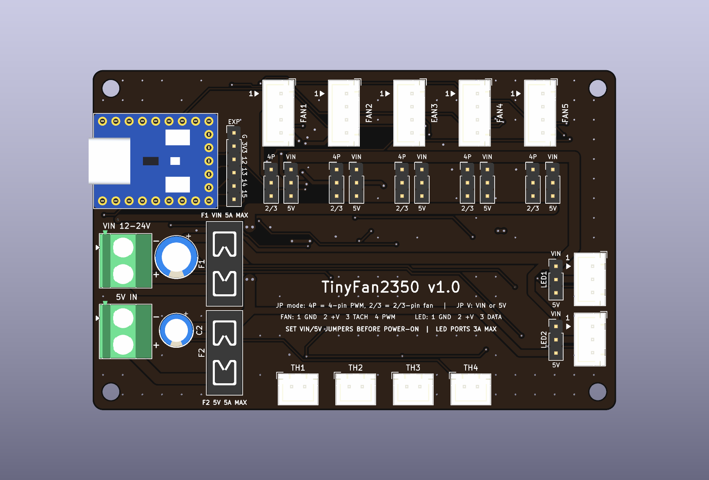
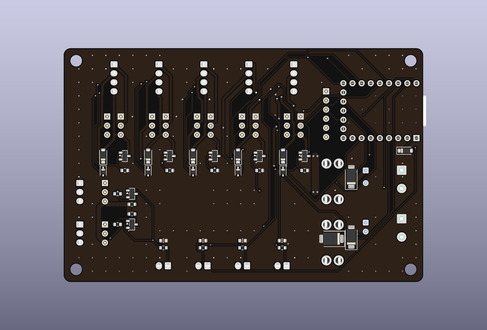

# Klipper TinyFan2350

A small Klipper fan / LED / thermistor controller based on the **Waveshare RP2350-Zero**, derived from [Gi7mo/TinyFan](https://github.com/Gi7mo/TinyFan).

  
  

|[• Build it](./Production)|[• Set it up](./Klipper)|[• Mount it](./Mount)|
|---|---|---|
|Order the PCB, parts list, soldering|Flashing, jumpers, wiring, Klipper config|Printable DIN rail mount|

## Features
- **5 fan ports** (JST-XH 4-pin) for 2-, 3- and 4-pin fans, 0.6A each
  - every fan has its own PWM output and tacho input -> independent speeds
  - per fan: mode jumper (**4P** = 4-pin PWM, **2/3** = switched GND) and voltage jumper (**VIN** or **5V**)
- **2 addressable LED ports** (JST-XH 3-pin), data level-shifted to 5V, VIN or 5V per port
- **4 thermistor ports** (JST-XH 2-pin) on the RP2350 ADC
- **EXP header** with 4 free GPIOs (GP12-GP15)
- Inputs: **12/24V (VIN)** and **5V**, each with a mini blade fuse and reverse-polarity protection, no converters on board
- All bottom-side SMD parts are **JLCPCB Basic** parts (cheap Economic assembly)
- 2 layers, 1 oz copper, black solder mask; SMD parts only on the bottom, THT only on the top; socketed MCU
- 100 x 65 mm, 4x M3 mounting holes (93 x 58 mm)

## Files
|[Pinout](./Images/TinyFan2350_Pinout.png)|[Schematic](./Production/TinyFan2350_Schematic.pdf)|[Klipper config](./Klipper/TinyFan2350.cfg)|[KiCad project](./KiCad)|[Pictures](./Images)|[Download](https://github.com/mokshmridul/TinyFan2350/releases/latest)|
|---|---|---|---|---|---|

## Notes
- Original TinyFan by [Gi7mo](https://github.com/Gi7mo/TinyFan), idea by [Rama](https://github.com/Ramalama2).
- This is a first revision: it passes KiCad ERC/DRC, but has not been built or tested yet.

## License
GPL-3.0, the same as the original TinyFan. See [LICENSE](./LICENSE).

## Disclaimer
This project is provided on an "as-is" basis, without any warranty of any kind. I am not responsible for any damage, injury, loss or other issues caused by building or using it. If you choose to build or use this board, you do so entirely at your own risk.
