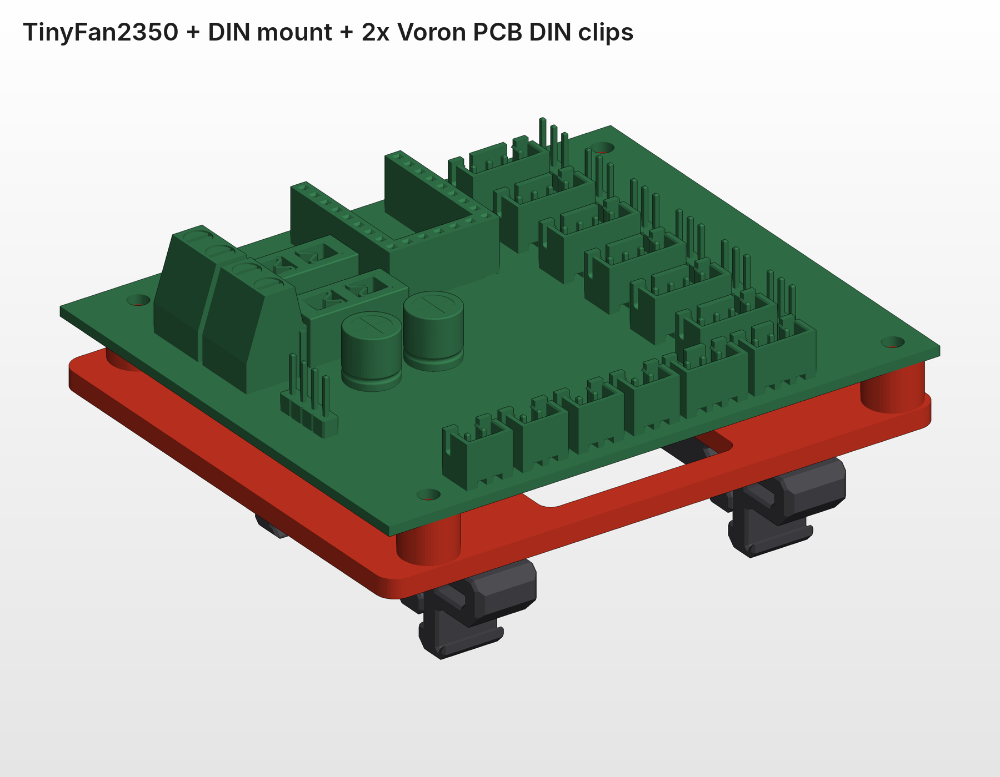

# TinyFan2350

A small Klipper fan and lighting controller built on the **Waveshare RP2350-Zero**. It runs six 4-pin PWM fans with tach feedback, two 5V WS2812 LED ports and four thermistor inputs. Each fan input has its own fuse.

Derived from [Gi7mo/TinyFan](https://github.com/Gi7mo/TinyFan) (RP2040-Zero), redesigned in KiCad 10.


| | |
|---|---|
| MCU | Waveshare RP2350-Zero (socketed), powered over USB from the Klipper host |
| Fan supply | **J1: VIN 12-24V**, 5A mini-blade fuse (F1) |
| Logic / LED supply | **J2: 5V**, 4A mini-blade fuse (F2) |
| Fans | 6 x JST-XH 4-pin (GND, +V, TACH, PWM), 25 kHz hardware PWM, tach on every port |
| Fan voltage | Per-port jumper: **VIN** or **5V** |
| LEDs | 2 x JST-XH 3-pin WS2812/SK6812 ports, 5V data via 74AHCT1G125 |
| Thermistors | 4 x JST-XH 2-pin (GP26-GP29), 4.7k 1% pull-up, 100nF filter |
| Expansion | 1x4 header: GND, 3V3, GP15, GP14 |
| PCB | 89 x 76 mm, 2-layer, 1.6 mm, 1 oz copper, 4 x M3 (75 x 67 mm pattern) |


## Quick start

1. **Order the PCB**: upload [`hardware/fab/TinyFan2350-gerbers.zip`](hardware/fab/TinyFan2350-gerbers.zip) to any 2-layer fab (JLCPCB, PCBWay, a local shop). Defaults are fine: 1.6 mm, 1 oz, HASL.
2. **Buy the parts**: [`hardware/fab/TinyFan2350-BOM.csv`](hardware/fab/TinyFan2350-BOM.csv).
3. **Assemble**: [docs/assembly.md](docs/assembly.md).
4. **Wire it up**: [docs/wiring.md](docs/wiring.md). **Set every fan jumper before you power on.**
5. **Flash Klipper and add the config**: [docs/klipper.md](docs/klipper.md) and [`klipper/tinyfan.cfg`](klipper/tinyfan.cfg).
6. **Mount it** on a DIN rail with the printed tray and two Voron Trident PCB DIN clips: [docs/mounting.md](docs/mounting.md).



## Repository layout

```
hardware/
  kicad/        KiCad 10 project (schematic, PCB, custom RP2350-Zero footprint/symbol)
  fab/          Gerbers + drill (zip and loose), BOM, pick-and-place
  3d/           STEP model of the assembled board
docs/
  images/       Renders and annotated pinout
  TinyFan2350-schematic.pdf
  assembly.md, wiring.md, klipper.md, mounting.md, design-notes.md
mechanical/
  TinyFan2350_DIN_mount.stl/.step/.py   Printable DIN tray (CadQuery source)
klipper/
  tinyfan.cfg   Ready-to-include Klipper config
```

## Safety notes

- **The fan voltage is whatever you feed J1.** If J1 gets 24V, every fan jumpered to VIN gets 24V. A 12V fan on 24V will be destroyed.
- J1 and J2 have **no reverse-polarity protection**. Every screw is labelled on the board (GND / VIN+ / 5V+). Check with a meter before you connect.
- The fuses are rated 32V DC. Do not feed J1 more than 24V nominal.
- The EXP header and thermistor ports are **3.3V only**.

## Status

v2.0 passes ERC and DRC with no errors and no unconnected nets. It has not been fabricated yet. Please open an issue if you build one.

## License

GPL-3.0, the same as the original TinyFan. See [LICENSE](LICENSE).
