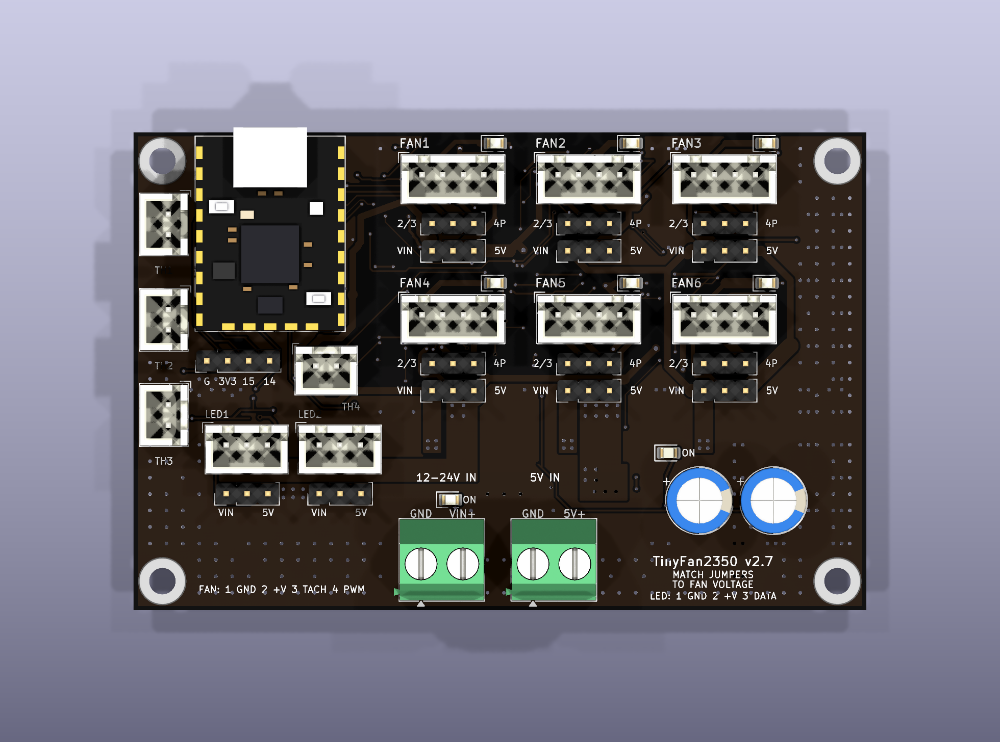
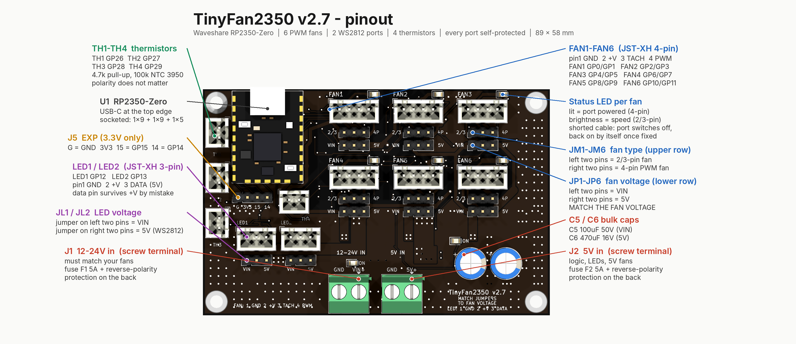

# TinyFan2350

A small Klipper fan and lighting controller built on the **Waveshare RP2350-Zero**. It runs six 4-pin PWM fans with tach feedback, two 5V WS2812 LED ports and four thermistor inputs. Each fan input has its own fuse.

Derived from [Gi7mo/TinyFan](https://github.com/Gi7mo/TinyFan) (RP2040-Zero), redesigned in KiCad 10.



| | |
|---|---|
| MCU | Waveshare RP2350-Zero (socketed), powered over USB from the Klipper host |
| Fan supply | **J1: VIN 12-24V**, 7.5A mini-blade fuse (F1) |
| Logic / LED supply | **J2: 5V**, 5A mini-blade fuse (F2) |
| Fans | 6 x JST-XH 4-pin (GND, +V, TACH, PWM). Per-port **MODE** jumper: 4-pin PWM fan (25 kHz, tach) **or** 2/3-pin fan switched by an AO3400A MOSFET (Klipper-Expander style). Status LED on every port |
| Fan voltage | Per-port jumper: **VIN** or **5V** |
| LEDs | 2 x JST-XH 3-pin addressable LED ports, 5V data via one 74HCT2G17 dual buffer. Per-port jumper: strip power from **5V** (WS2812/SK6812) or **VIN** (12/24V WS2815 etc.) |
| Indicators | VIN ON and 5V ON LEDs, one status LED per fan port |
| Thermistors | 4 x JST-XH 2-pin (GP26-GP29), 4.7k 1% pull-up, 100nF filter |
| Expansion | 1x4 header: GND, 3V3, GP15, GP14 |
| Protection | Every fan port (fans up to ~1A each) and LED port has a **resettable fuse** (a shorted cable switches off just that port, and it comes back by itself). LED data pins survive +V by mistake (1k + clamp). Fan MOSFET gates are zener-clamped. TVS diodes behind F1/F2: reverse polarity, or 12-24V into the 5V input, blows the fuse instead of the board |
| PCB | **100 x 63 mm**, 2-layer, 1.6 mm, black, **2 oz copper**, 4 x M3 (86 x 54 mm pattern) |



## Quick start

1. **Order the board, fully assembled**: follow [docs/ordering.md](docs/ordering.md). Upload [`TinyFan2350_GERBERS_upload.zip`](hardware/fab/TinyFan2350_GERBERS_upload.zip), [`TinyFan2350_BOM_JLCPCB.csv`](hardware/fab/TinyFan2350_BOM_JLCPCB.csv) and [`TinyFan2350_CPL_JLCPCB.csv`](hardware/fab/TinyFan2350_CPL_JLCPCB.csv) to JLCPCB (for PCBWay use [`TinyFan2350_BOM_PCBWay.csv`](hardware/fab/TinyFan2350_BOM_PCBWay.csv) with the same CPL).
2. **Buy the rest**: RP2350-Zero, socket strips, fuses, jumpers and mount hardware. The BOM lists every part with its maker's part number.
3. **Finish it**: solder the three RP2350-Zero socket strips ([docs/assembly.md](docs/assembly.md)). Or hand-build the whole board from the same guide.
4. **Wire it up**: [docs/wiring.md](docs/wiring.md). **Set every fan jumper before you power on.**
5. **Flash Klipper and add the config**: [docs/klipper.md](docs/klipper.md) and [`klipper/tinyfan.cfg`](klipper/tinyfan.cfg).
6. **Mount it** on a DIN rail with the printed tray and two Voron Trident PCB DIN clips: [docs/mounting.md](docs/mounting.md).


## Repository layout

```
hardware/
  kicad/        KiCad 10 project (schematic, PCB, custom RP2350-Zero footprint/symbol)
  fab/          Gerbers + drill (zip and loose), JLCPCB BOM + CPL, PCBWay BOM, KiCad pick-and-place
  3d/           STEP model of the assembled board
docs/
  images/       Renders and annotated pinout
  TinyFan2350-schematic.pdf
  ordering.md, assembly.md, wiring.md, klipper.md, mounting.md, design-notes.md
mechanical/
  TinyFan2350_DIN_mount.stl/.step/.py   Printable DIN tray (CadQuery source)
klipper/
  tinyfan.cfg   Ready-to-include Klipper config
```

## Safety notes

- **The fan voltage is whatever you feed J1.** If J1 gets 24V, every fan jumpered to VIN gets 24V. A 12V fan on 24V will be destroyed.
- J1 and J2 have **no reverse-polarity protection**. Every screw is labelled on the board (GND / VIN+ / 5V+). Check with a meter before you connect.
- The fuses are rated 32V DC. Do not feed J1 more than 24V nominal.
- The EXP header and thermistor ports are **3.3V only**.

## Status

v2.3 passes ERC and DRC (KiCad 10.0.8) with no errors and no unconnected nets, and every pad's net has been checked against the design table by script. It has not been fabricated yet. Please open an issue if you build one.

## License

GPL-3.0, the same as the original TinyFan. See [LICENSE](LICENSE).
