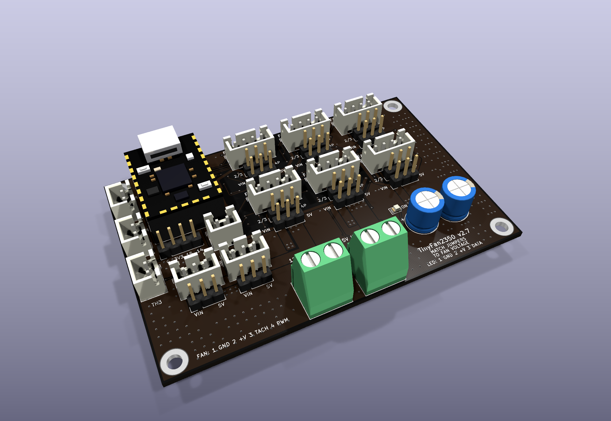
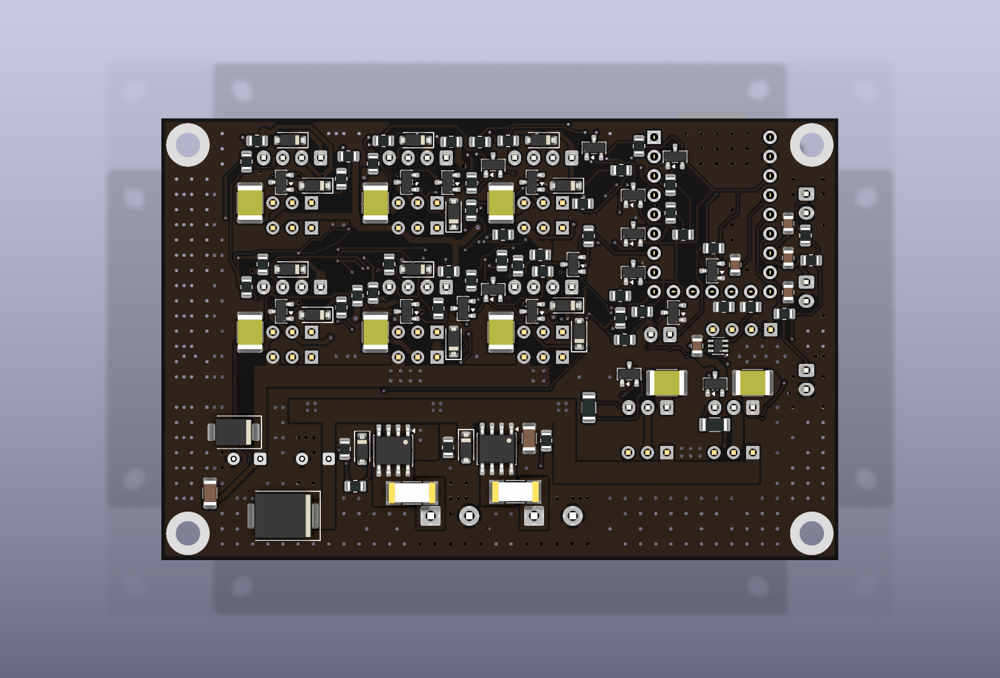
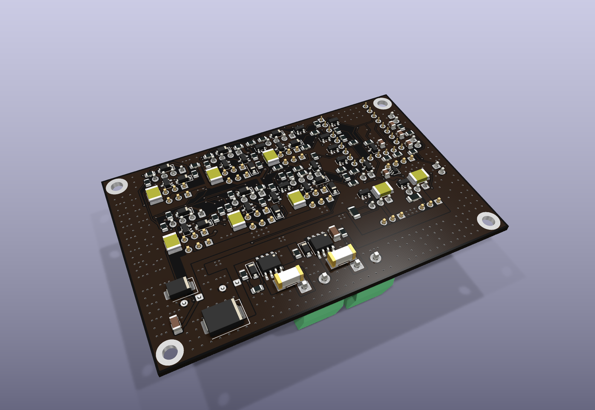

# TinyFan2350

TinyFan2350 is a small add-on board for a 3D printer that runs **Klipper**. It controls up to **six fans**, **two addressable LED strips** (WS2812 and similar) and reads **four temperature sensors** (thermistors). A **Waveshare RP2350-Zero** does the work. It's a thumb-sized microcontroller board that plugs into sockets on the TinyFan, and it talks to your printer's Raspberry Pi (or similar) over a USB cable.

It is based on [Gi7mo/TinyFan](https://github.com/Gi7mo/TinyFan) (RP2040-Zero) and was redesigned in KiCad 10.



| Top | Bottom |
|---|---|
|  |  |



## What it does

| | |
|---|---|
| **Brain** | Waveshare RP2350-Zero in sockets. It is powered by its own USB cable from the Klipper host |
| **Power in** | **J1: 12 V or 24 V** for fans (and 12/24 V LED strips), with a 5 A fuse (F1). **J2: 5 V** for 5 V fans and 5 V LED strips, with a 5 A fuse (F2). Both fuses are soldered on by the factory |
| **Fans** | 6 ports (JST-XH 4-pin). Each port works with **4-pin PWM fans** (speed control plus RPM reading) **or 2/3-pin fans** (switched on and off fast by the board to set the speed). Each port can be set to 12/24 V or 5 V. A small green light shows when a port has power |
| **LED strips** | 2 ports (JST-XH 3-pin) for addressable strips. Each port can be powered from 5 V (WS2812B, SK6812) or from J1 (12/24 V strips such as WS2815) |
| **Temperature** | 4 ports (JST-XH 2-pin) for standard 100k thermistors |
| **Extra pins** | One small 4-pin header (GND, 3.3 V, GP14, GP15) for a door switch, sensor and similar |
| **Protection** | Every fan port and LED port has its own **self-resetting fuse**: a shorted cable switches off just that port, and it works again once you fix the cable. If you wire the power the wrong way round, nothing happens at all: an electronic switch on each input stays off until you fix it. Too high a voltage blows the main fuse instead of the board. All the main parts run well below their maximum ratings at 24 V (see [design notes](docs/design-notes.md#safety-margins)) |
| **Board** | 89 x 58.1 mm, black, 2 layers, 1 oz copper (2 oz optional). Four M3 holes in the corners, 82 x 51.1 mm apart. A printable DIN-rail mount is included |


## Build one in six steps

1. **Order the board, already assembled**: [docs/ordering.md](docs/ordering.md) walks you through JLCPCB or PCBWay screen by screen. You upload three files from [`hardware/fab/`](hardware/fab).
2. **Buy the few extra parts**: the RP2350-Zero, female header strips for its socket, and jumper caps. See the list in [ordering.md](docs/ordering.md#what-you-buy-yourself).
3. **Solder the socket** for the RP2350-Zero (three short female header strips). [docs/assembly.md](docs/assembly.md) shows how, and also how to build the whole board by hand if you prefer.
4. **Wire it up and set the jumpers**: [docs/wiring.md](docs/wiring.md). **Set every fan jumper before you switch the power on.**
5. **Install Klipper on it and add the config**: [docs/klipper.md](docs/klipper.md) and [`klipper/tinyfan.cfg`](klipper/tinyfan.cfg).
6. **Mount it** on a DIN rail with the printed tray and one Voron Trident PCB DIN clip: [docs/mounting.md](docs/mounting.md).


## Three rules that keep it safe

1. **Fans get the voltage you feed in.** The board does not convert voltage. If J1 gets 24 V, every fan whose jumper is on VIN gets 24 V. A 12 V fan on 24 V will burn out, and a 5 V fan or 5 V LED strip on VIN dies at once. Check each jumper against the fan's label.
2. **Check + and - with a meter before you connect power.** Each screw is labelled on the board (GND / VIN+ / 5V+). Wiring it backwards will not damage anything (the board just stays off), but 12/24 V into the 5 V input blows the soldered F2 fuse.
3. **Stay at 24 V or below on J1.** The board is designed for 12 V or 24 V supplies (a 24 V supply turned up to 28 V is still fine). The thermistor ports and the EXP header are **3.3 V only**.

## Words you will see

| Word | Meaning |
|---|---|
| **VIN** | The 12 V or 24 V you feed into J1 |
| **Jumper** | A small plastic cap that connects two of three pins. Where you put it chooses an option |
| **PWM** | How speed is controlled: power is switched on and off very fast. 4-pin fans have a wire just for this |
| **Tach** | The fan's speed signal, used to show RPM |
| **PTC** | A self-resetting fuse. It switches off when too much current flows and comes back once it cools |
| **TVS** | A protection diode. It shorts out too-high input voltage so the main fuse blows |
| **Reverse-polarity switch** | A MOSFET on each input that only turns on when + and - are the right way round |
| **Klipper host** | The computer that runs Klipper (usually a Raspberry Pi) |

## What is in this repository

```
hardware/
  kicad/        KiCad 10 project: schematic (6 sheets), PCB, custom parts, simple 3D models for the RP2350-Zero and the fuses
  fab/          Files for the factory: Gerbers, BOMs (parts lists) and CPL (part positions)
  3d/           3D model (STEP) of the finished board
docs/
  images/       Pictures and the pinout
  TinyFan2350-schematic.pdf    The circuit diagram
  TinyFan2350-pcb-copper.pdf   Top and bottom copper layers
  ordering.md, assembly.md, wiring.md, klipper.md, mounting.md, design-notes.md
mechanical/
  TinyFan2350_DIN_mount.stl/.step/.py   Printable DIN rail tray (CadQuery source)
klipper/
  tinyfan.cfg   Ready-to-use Klipper config
```

## Status

v2.7 passes KiCad's electrical check (ERC) and layout check (DRC) with zero errors and nothing left unconnected. Scripts also check that every pad connects to the right signal and that no two nets touch or come closer than 0.15 mm. The board has **not been built yet**. If you build one, please open an issue and tell us how it went.

## License

GPL-3.0, the same as the original TinyFan. See [LICENSE](LICENSE).
