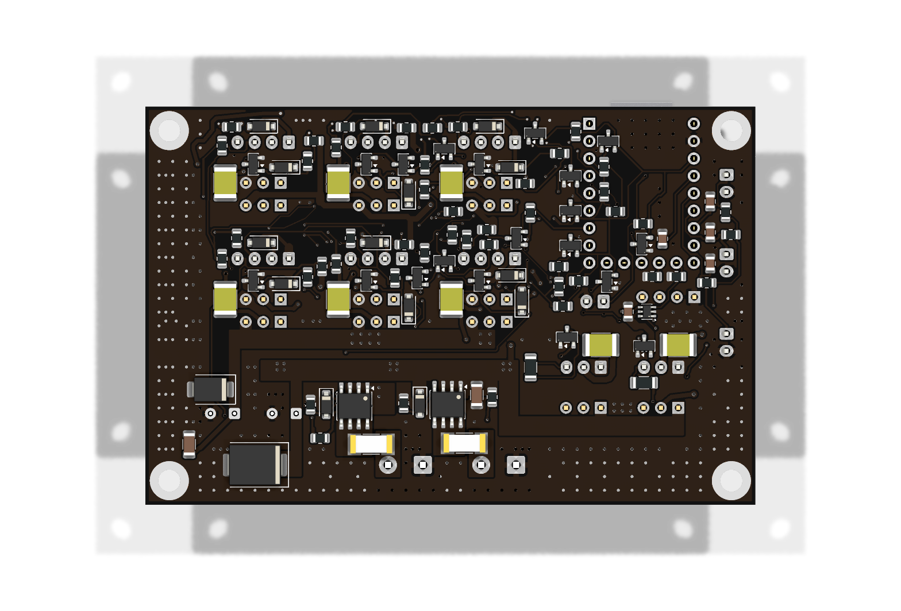
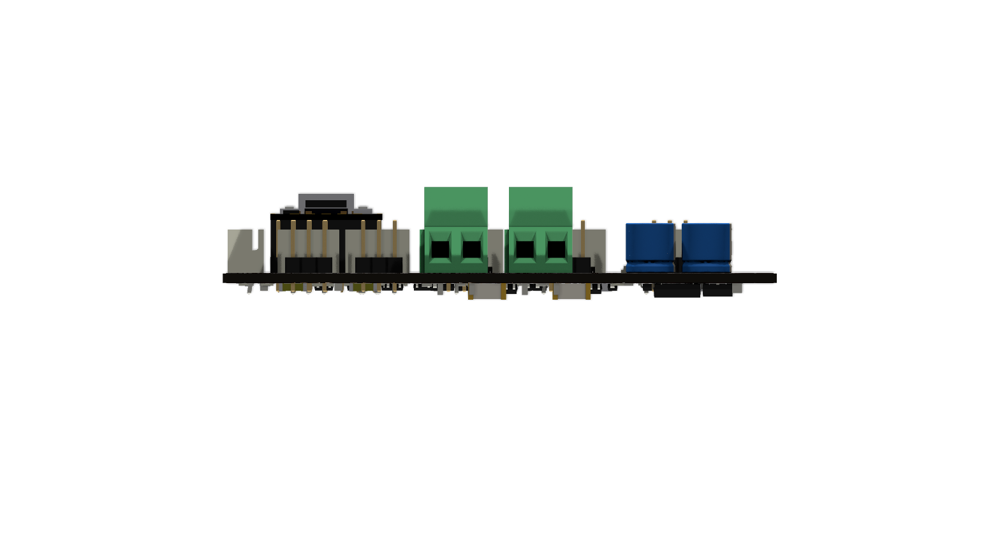

# Assembly guide

There are three ways to build a TinyFan2350. Pick the one that matches how much soldering you want to do.

| Route | What the factory does | What you solder |
|---|---|---|
| **1. Fully assembled** (easiest) | Everything ([ordering.md](ordering.md)) | Only the RP2350-Zero socket (step 4 below) |
| **2. Bottom side only** (cheaper) | All the small parts on the bottom | The 8 green LEDs on top (step 2), then step 4 |
| **3. All by hand** | Nothing, bare board only | Everything, steps 1 to 4 |

Never soldered small parts before? Route 1 or 2 is a good choice. The only soldering then is big, easy through-hole pins.

## Tools

- A soldering iron with temperature control and a fine chisel tip, plus flux and thin solder (0.5-0.8 mm)
- Tweezers and desoldering wick (for removing extra solder)
- A multimeter (you only need the beep/continuity mode and the DC volts mode)

## Before you start

- Most small parts sit on the **bottom** side. Only the 8 green status LEDs (LD1-LD8) are on the top, so you can see them.
- All connectors, jumper pins and the two big round capacitors are **through-hole** parts on the top. You push their legs through the holes and solder them from the bottom.
- The bottom has no part labels printed next to the parts (no room). To find a part, open `hardware/kicad/TinyFan2350.kicad_pcb` in KiCad and hover over it, or use the X/Y numbers in `hardware/fab/TinyFan2350-pos.csv`.
- Work from the lowest parts to the tallest. That way the board lies flat while you solder.

## 1. Small parts on the bottom (route 3 only)

The sizes are 0805, 1206, 1812, 2410 (the main fuses), SOT-23 (3 legs), SOD-123 (small diode), SMB/SMC (big diodes), SOIC-8 (Q1/Q2, 8 legs 1.27 mm apart), plus **one tiny 6-leg chip, U2** (SOT-363, legs 0.65 mm apart). For U2 use a fine tip, lots of flux and a magnifier. Do U2 first, while nothing else is in the way.

**Which way round?** Diodes have a stripe (the cathode). It goes on the pad that the board marks as pad 1. 3-legged parts only fit one way: the single leg goes on the single pad.

| Refs | Part | What it does / notes |
|---|---|---|
| U2 | 74HCT2G17 (SOT-363) | Boosts the LED data from 3.3 V to 5 V. The dot on the chip goes to the dot on the board. Must be **HCT**, not HC |
| Q1 | AO4485 (SOIC-8) | Reverse-polarity switch for the 12/24 V input, just above F1. **Dot (pin 1) to the pin-1 mark** |
| Q2 | AO4407A (SOIC-8) | Reverse-polarity switch for the 5 V input, just above F2. **Dot (pin 1) to the pin-1 mark** |
| F1, F2 | Littelfuse Nano2 5 A slow-blow (2410) | Main fuses, right behind the J1 and J2 screw terminals. Either way round |
| D23, D24 | BZT52C5V6 (SOD-123) | Protect the gates of Q1 and Q2. Stripe on pad 1 |
| R65, R66 | 22k 0805 | Turn Q1 and Q2 on |
| Q10-Q15 | 2N7002 (SOT-23) | Boost each fan's speed signal from 3.3 V to 5 V. Next to each fan connector |
| Q4-Q9 | SI2308A (SOT-23) | The switch for 2/3-pin fans, between each fan connector and its jumpers. **60 V part**: don't swap it for a 30 V AO3400A |
| D1-D6 | BAT54S (SOT-23) | Protect the RPM inputs. Under and just right of the RP2350-Zero. Must be **BAT54S** (not BAT54, BAT54A or BAT54C) |
| D19, D20 | BAT54S (SOT-23) | Protect the LED data lines, near U2 |
| D7-D12 | B5819W (SOD-123) | Catch the voltage spike when a fan switches off. Stripe on pad 1, as printed |
| D13-D18 | BZT52C5V6 (SOD-123) | Keep the switch MOSFET's input below its limit. Stripe on pad 1 |
| D21 | SMCJ30A (SMC, big) | Protects the 12/24 V input. Stripe on pad 1, as printed |
| D22 | SMBJ5.0A (SMB, big) | Protects the 5 V input. Stripe on pad 1, as printed |
| F3-F8 | PTC 1.5 A 33 V (1812) | Self-resetting fuse, one per fan port. Either way round |
| F9, F10 | PTC 2 A 33 V (1812) | Self-resetting fuse, one per LED port, just above the LED connectors. Either way round |
| R47-R64 | 10k 0805 | Pull-ups for the speed and RPM signals |
| R33-R39 | 10k 0805 | Resistors for the green fan and VIN lights |
| R31, R32 | 10k 0805 | Keep the LED strips dark while the RP2350 starts up |
| R40 | 1k 0805 | Resistor for the 5V ON light |
| R19, R20 | 1k 1206 | LED data line protection |
| R21-R26 | 10k 0805 | RPM input protection |
| R27-R30 | 4.7k 1% 0805 | Thermistor resistors, near TH1-TH4 |
| R41-R46 | 22k 0805 | Switch MOSFET input resistors, next to each fan's switch |
| C1, C2 | 10 µF 50 V 1206 | Smooth the inputs. C1 next to Q1, C2 next to C6 |
| C3, C7-C10 | 100 nF 0805 | Small smoothing capacitors |

**Check now:** look at U2's legs under a magnifier for solder bridges. With the meter in beep mode, check that **VIN, +5V and +3V3 do not beep against GND** (measure at the J1/J2 screw terminal pins and the EXP header).

## 2. The 8 green LEDs on top (routes 2 and 3)

| Refs | Part | Notes |
|---|---|---|
| LD1-LD8 | Green LED 0805 | The cathode mark (a green line or a dot on the part) goes on pad 1, the marked pad |

## 3. Through-hole parts on top (route 3 only)

Low parts first:

1. **Jumper pins**: JP1-JP6, JM1-JM6, JL1-JL2 (1 x 3 pins each), and J5 (1 x 4) if you want it.
2. **JST-XH connectors**: FAN1-FAN6 (4-pin), J3/J4 (LED, 3-pin), J6-J9 (TH1-TH4, 2-pin). The small ramp on the connector faces the same way as its outline on the board.

Then the tall parts:

3. **C5 (100 µF) and C6 (470 µF).** These have a + and a -. The longer leg (+) goes in the **square pad**, next to the `+` on the board. The stripe on the side of the capacitor marks the - leg.
4. **J1, J2 screw terminals.** The wire openings face the bottom edge of the board.

## 4. The RP2350-Zero socket (all routes)

The RP2350-Zero is not soldered to the board. It plugs into female header strips, so you can swap it later.

1. Cut a 2.54 mm female header strip into **two 9-pin pieces and one 5-pin piece**. Cut through the 10th (or 6th) hole and file the edge smooth.
2. If your RP2350-Zero has no pins yet, solder male pin headers to it: both 9-pin sides and the 5-pin row on the end (GP9-GP13).
3. Plug the female strips onto the module's pins, then drop the whole thing into the holes on the TinyFan. Doing it this way keeps the strips straight.
4. Solder the strips from the bottom. Then pull the module out.
5. When you plug the module back in, the **USB-C connector points to the top edge** of the board, as the outline on the board shows.

## Before you power it on the first time

1. Put the meter in beep mode and check:
   - J1 **VIN+** screw to J1 **GND** screw: **no beep**
   - J2 **5V+** screw to J2 **GND** screw: **no beep**

   A beep means a short. Find it before you go on.
2. With **no fans plugged in**, connect 5 V to J2 and your 12/24 V to J1. Both power lights (the two ON lights above the screw terminals) should light. **If one stays dark, that input is probably wired backwards.** The board is protected and nothing is damaged: switch off, swap the two wires, try again. With the meter on DC volts, check:
   - a fan's voltage jumper (JP, the lower row) middle pin, with the cap on the left pair: **VIN** (12 or 24 V)
   - the same pin with the cap on the right pair: **5 V**
   - J3/J4 pin 2 with the LED V cap on 5 V: **5 V**
3. Plug the RP2350-Zero into your Klipper host by USB and install Klipper on it ([klipper.md](klipper.md)).
4. Set every fan's jumpers ([wiring.md](wiring.md)), then plug the fans in.

