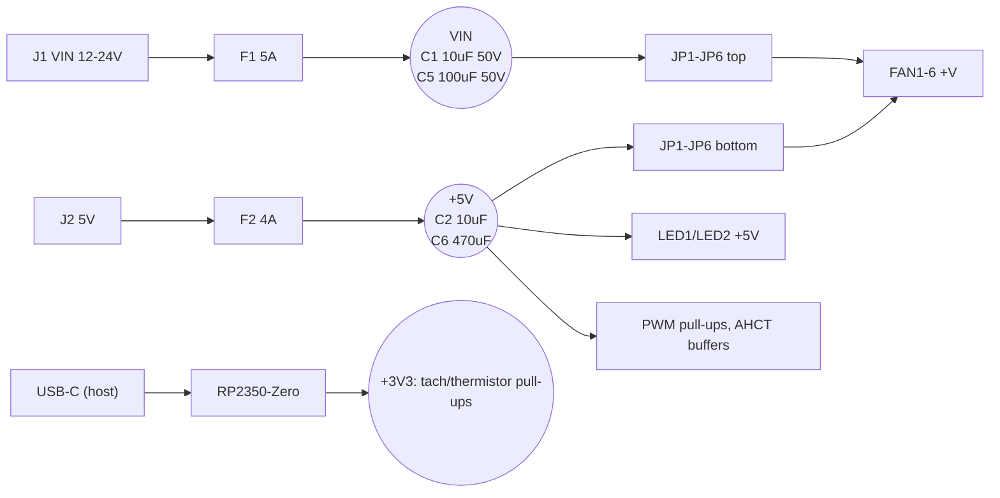

# Design notes

Schematic: [TinyFan2350-schematic.pdf](TinyFan2350-schematic.pdf). KiCad project: [`hardware/kicad`](../hardware/kicad) (KiCad 10).

## Power



- The RP2350-Zero is powered **only from USB**. Its 5V pin is left unconnected, so USB 5V and J2 5V can never back-feed each other.
- There is no on-board regulation of VIN. Anything from 12V to 24V works. The VIN-side parts are rated for that: the fuses and holders are 32V, C1 and C5 are 50V, and the BSS138 is 50V (though it only ever sees 5V).
- Copper: VIN and 5V trunks are 2-3 mm wide on 1 oz copper, and fan feeds are at least 0.8 mm. A resistive-network simulation of the routed board gives about a 10 °C rise for 4A on the narrowest 5V trunk section, which is the F2 limit. Realistic loads are well below that. Both layers have a GND pour.

## Fan PWM (x6)

The RP2350 GPIO (3.3V) drives a BSS138 with its gate tied to 3V3 and its source on the GPIO, which is the classic bidirectional open-drain shifter. The drain is pulled up to 5V with 10k. Logic is non-inverting. Fans have their own internal pull-up on PWM, so it ends up as an open-drain 5V signal, as the Intel 4-wire spec expects.

## Fan tach (x6)

```
FAN TACH (XH pin 3) --+-- 10k --> 3V3
                      |
                      +-- 4.7k --+--> GPIO
                                 |
                          BAT54S clamp to GND and 3V3
```

Tach is an open collector in the fan, pulled up to 3V3. The 4.7k series resistor and the Schottky clamp limit the current into the RP2350 to a few mA if a miswired or non-standard fan puts VIN (up to 24V) on the tach wire.

The RP2350 has a known erratum (E9): a GPIO with its input enabled can latch at ~2V when driven weakly. The 10k external pull-up drives the line hard enough that this doesn't apply here.

## WS2812 (x2)

74AHCT1G125 buffer, powered from 5V, with OE tied to GND (always enabled). AHCT input thresholds accept 3.3V logic and the output swings the full 5V. A 330R series resistor damps ringing on long cables.

## Thermistors (x4)

4.7k 1% pull-up to 3V3, 100nF to GND at the ADC pin, with the 100k NTC to GND through the connector. On RP2350A the ADC pins are GP26-GP29. Klipper configures these pins as analog with the digital input disabled, so erratum E9 doesn't affect them either.

## Changes from the original TinyFan

| | TinyFan (Gi7mo) | TinyFan2350 v2.0 |
|---|---|---|
| MCU | RP2040-Zero | RP2350-Zero (same footprint and pinout), socketed |
| Input | 24V + on-board converter | Separate VIN 12-24V and 5V inputs, each with its own fuse |
| Fans | 2/3/4-pin, fixed voltage | 6 x 4-pin JST-XH, per-port VIN/5V jumper, tach with protection |
| LEDs | - | 2 x WS2812 ports, buffered |
| Sensors | - | 4 x thermistor ports |
| Size | ~60 x 62 mm | 84 x 76 mm |

## Verification

- ERC: 0 errors.
- DRC (KiCad 10.0.8): 0 violations, 0 unconnected.
- Every pad net (221 pads) checked against the design table by script.
- Clearances: 0.2 mm signals, 0.25 mm GND/fan power, 0.3 mm VIN/5V. Copper is kept at least 0.7 mm from the board edge.
