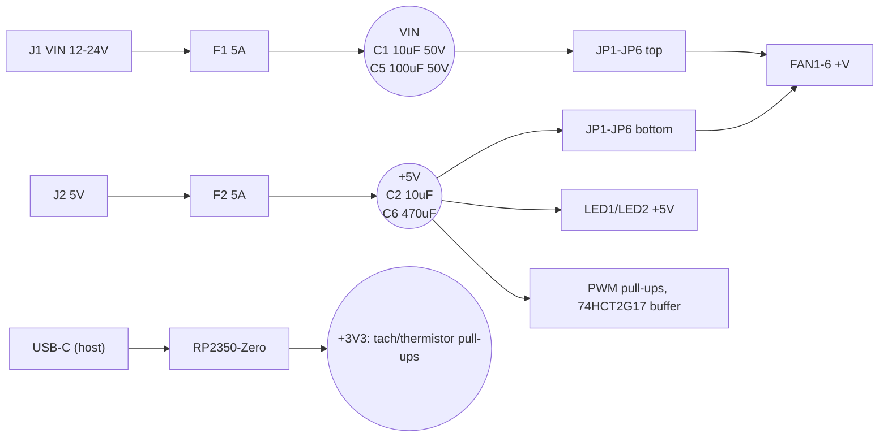

# Design notes

Schematic: [TinyFan2350-schematic.pdf](TinyFan2350-schematic.pdf). KiCad project: [`hardware/kicad`](../hardware/kicad) (KiCad 10).

## Power



- The RP2350-Zero is powered **only from USB**. Its 5V pin is left unconnected, so USB 5V and J2 5V can never back-feed each other.
- There is no on-board regulation of VIN. Anything from 12V to 24V works. The VIN-side parts are rated for that: the fuses and holders are 32V, C1 and C5 are 50V, and the BSS138DW is 50V (though it only ever sees 5V).
- Copper: VIN and 5V trunks are 2-3 mm wide on 1 oz copper, and the short feeds from each jumper to its fan connector are 0.4-1.2 mm (about 1A per fan). A resistive-network simulation of the routed board puts the narrowest trunk section (2.0 mm) at about a 15-17 °C rise at a continuous 5A, the fuse limit. That is inside the usual 20 °C design limit, and realistic loads are well below it. 2 oz copper brings it to about 6 °C. Both layers have a solid GND pour, connected solidly to every GND pad.

## Fan PWM (x6)

Each fan uses one half of a BSS138DW dual MOSFET (Q1 = FAN1+2, Q2 = FAN3+4, Q3 = FAN5+6). The gate is tied to 3V3 and the source is on the GPIO, which is the classic bidirectional open-drain shifter. The GPIO side is pulled up to 3V3 with 10k and the fan side to 5V with 10k, both from the EXB-38V103JV arrays (RN1/RN3/RN5). If the RP2350 is unplugged or still booting, the fan side floats high and the fans run at **full speed**, which is the safe failure. Logic is non-inverting. Fans have their own internal pull-up on PWM, so it ends up as an open-drain 5V signal, as the Intel 4-wire spec expects.

## Fan tach (x6)

```
FAN TACH (XH pin 3) --+-- 10k (RN2/RN4/RN6) --> 3V3
                      |
                      +-- 4.7k --+--> GPIO
                                 |
                          BAT54S clamp to GND and 3V3
```

Tach is an open collector in the fan, pulled up to 3V3. The 4.7k series resistor and the Schottky clamp limit the current into the RP2350 to a few mA if a miswired or non-standard fan puts VIN (up to 24V) on the tach wire.

The RP2350 has a known erratum (E9): a GPIO with its input enabled can latch at ~2V when driven weakly. The 10k external pull-up drives the line hard enough that this doesn't apply here.

## WS2812 (x2)

One 74HCT2G17 dual Schmitt-trigger buffer drives both ports. It is powered from 5V. HCT inputs switch at under 2V, so 3.3V logic is read reliably, and the outputs swing the full 5V (at least 4.1V at 4mA). Each input has a 10k pull-down (R31/R32), so the LED data line is held low and the strips stay dark while the RP2350 is unplugged or booting. A 330R series resistor (R19/R20) damps ringing on long cables.

## Thermistors (x4)

4.7k 1% pull-up to 3V3, 100nF to GND at the ADC pin, with the 100k NTC to GND through the connector. On RP2350A the ADC pins are GP26-GP29. Klipper configures these pins as analog with the digital input disabled, so erratum E9 doesn't affect them either.

## Changes from the original TinyFan

| | TinyFan (Gi7mo) | TinyFan2350 v2.1 |
|---|---|---|
| MCU | RP2040-Zero | RP2350-Zero (same footprint and pinout), socketed |
| Input | 24V + on-board converter | Separate VIN 12-24V and 5V inputs, each with its own fuse |
| Fans | 2/3/4-pin, fixed voltage | 6 x 4-pin JST-XH, per-port VIN/5V jumper, tach with protection |
| LEDs | - | 2 x WS2812 ports, buffered |
| Sensors | - | 4 x thermistor ports |
| Size | ~60 x 62 mm | 87 x 63 mm |

## Verification

- ERC: 0 errors.
- DRC (KiCad 10.0.8): 0 violations, 0 unconnected.
- Every pad net (218 connected pins, 67 parts) checked against the design table by script.
- Clearances: 0.18 mm signals (0.15 mm neck-downs at fine-pitch pads), 0.2 mm GND/fan power, 0.25-0.3 mm VIN/5V. Copper is kept at least 0.7 mm from the board edge. All of it is well inside JLCPCB's and PCBWay's standard 2-layer capabilities.
