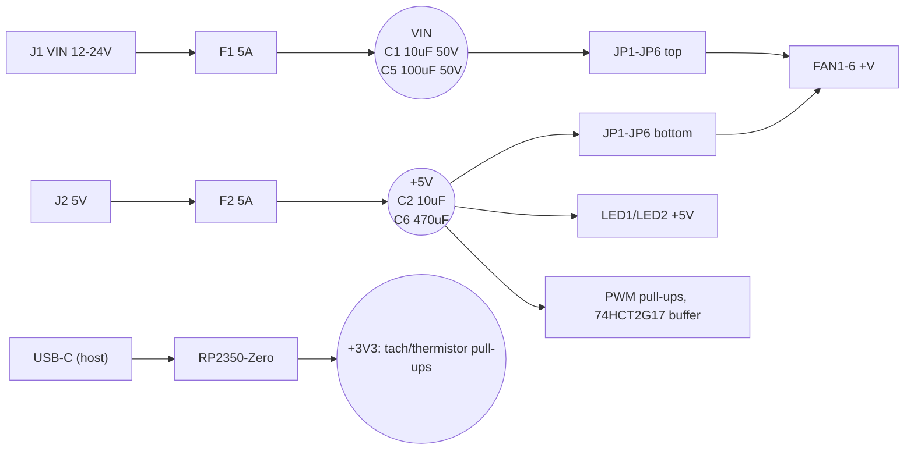

# Design notes

Schematic: [TinyFan2350-schematic.pdf](TinyFan2350-schematic.pdf). KiCad project: [`hardware/kicad`](../hardware/kicad) (KiCad 10).

## Schematic layout

The schematic is hierarchical:

| Sheet | File | What is on it |
|---|---|---|
| Root | `TinyFan2350.kicad_sch` | Block diagram: which MCU pin goes to which channel |
| Power | `power.kicad_sch` | J1/J2, F1/F2 fuses, bulk caps, TVS crowbars, power LEDs, mounting holes |
| MCU | `mcu.kicad_sch` | RP2350-Zero pin map, EXP header J5 |
| FAN1..FAN6 | `fan_channel.kicad_sch` (one file, used 6x) | PWM level shifter, tach input + clamp, fan connector, VIN/5V jumper, flyback, status LED, 2/3-pin low-side switch, PTC |
| LEDs | `leds.kicad_sch` | 74HCT2G17 buffer, data resistors and clamps, two WS2812 ports with their jumpers and PTCs |
| Thermistors | `thermistors.kicad_sch` | Four 4.7k pull-up + 100 nF inputs |

`VIN`, `+5V`, `+3V3` and `GND` are global power symbols; the root sheet only carries signals between the MCU and the channels. Nets inside a channel are named per instance, e.g. `/FAN3/FAN_GND`. Each part keeps its board reference designator; the fan sheet has a table mapping FAN1..FAN6 to their R/Q/D/F numbers.

## Track corners and EMI

90° track corners are a long-lived myth as an EMI source: their extra capacitance only matters at multi-GHz edge rates, and the fastest signal here is the 800 kHz WS2812 data line (25 kHz fan PWM). What does matter on this board is the return path, so v2.4.1 adds 87 GND stitching vias between the top and bottom ground pours, and keeps the solid pours under the signal tracks. Right-angle corners were still chamfered to 45° where clearance allowed, for neatness and to avoid acid traps (none of the remaining ones are acute).

## Power



- The RP2350-Zero is powered **only from USB**. Its 5V pin is left unconnected, so USB 5V and J2 5V can never back-feed each other.
- There is no on-board regulation of VIN. Anything from 12V to 24V works. The VIN-side parts are rated for that: the fuses and holders are 32V, C1 and C5 are 50V, and the 2N7002s are 60V (though they only ever see 5V).
- Copper: VIN and 5V trunks are 2-3 mm wide on 1 oz copper, and the short feeds from each jumper to its fan connector are 0.4-1.2 mm (about 1A per fan). A resistive-network simulation of the routed board puts the narrowest trunk section (2.0 mm) at about a 15-17 °C rise at a continuous 5A, the fuse limit. That is inside the usual 20 °C design limit, and realistic loads are well below it. 2 oz copper brings it to about 6 °C. Both layers have a solid GND pour. SMD GND pads connect solidly; through-hole GND pins connect with four 0.8 mm thermal spokes so they are easy to hand-solder.

## Fan PWM (x6)

Each fan has its own 2N7002 MOSFET (Q10-Q15 = FAN1-FAN6). The gate is tied to 3V3 and the source is on the GPIO, which is the classic bidirectional open-drain shifter. The GPIO side is pulled up to 3V3 with 10k and the fan side to 5V with 10k, all discrete 0805 resistors (R47-R64). If the RP2350 is unplugged or still booting, the fan side floats high and the fans run at **full speed**, which is the safe failure. Logic is non-inverting. Fans have their own internal pull-up on PWM, so it ends up as an open-drain 5V signal, as the Intel 4-wire spec expects.

## Fan mode: 4-pin or 2/3-pin (x6)

The fan connector's pin 1 (GND) goes to the MODE jumper JMx and to the drain of an AO3400A MOSFET whose source is on the port's return (FANx_RET, which reaches GND through the port's PTC).

- **JM on the bottom two pins (4-pin):** the jumper ties pin 1 to the port's return (FANx_RET), which goes to GND through the port's PTC. The MOSFET is shorted out and does nothing, and the fan is controlled on its PWM wire as above.
- **JM on the top two pins (2/3-pin):** pin 1 only reaches the return through the MOSFET. Its gate is driven (through a 22k resistor, clamped by a 5.6V zener) by the same 5V PWM line (the fan side of the 2N7002 shifter), so the GPIO's PWM switches the fan's ground, like the Klipper Expander's outputs. A B5819W Schottky across the fan (cathode to +V) catches the motor's turn-off spike. The pull-up holds the gate high when the RP2350 is unplugged, so the fan runs at full speed, the same safe failure as the 4-pin mode.
- The gate is pulled up through 10k, so it turns on in a few microseconds. That is fine at 100 Hz but too slow for 25 kHz: use `cycle_time: 0.010` for 2/3-pin ports (see `klipper/tinyfan.cfg`).
- The status LED (10k from the fan's +V to pin 1) lights whenever the port is powered. In 2/3-pin mode its brightness follows the fan speed. It is dim on 5V fans and bright on 24V fans.
- AO3400A: 30V, 5.7A, about 30 mOhm at 5V gate drive, so it barely warms at the 1A per port that the traces are sized for.

## Current budget (v2.4)

Sized for up to **5A on VIN** with **1 oz copper and a 5A F1**, for example 3 x 0.8A + 3 x 0.2A fans (3A) at 12V or 24V. The resistive simulation puts the 2 mm VIN spine at about 76% of its 10 °C-rise capacity at 3A and about 127% (roughly 17 °C) at the 5A fuse limit. If you need more on VIN (six 0.8A fans plus LED strips, ~6.8A), order **2 oz copper and fit a 7.5A fuse**: at 2 oz the spine sits about 10 °C above ambient at 6.8A. Each fan's own traces (0.375-1.2 mm) are good for 1A. F2 (5V) stays 5A.

## Port protection (v2.3)

The goal is that a badly crimped cable kills a fan at worst, never the board.

- **Fan ports:** each port's ground return (FANx_RET: the MODE jumper's 4-pin side and the AO3400A source) goes to GND through a 1.6A / 30V PTC resettable fuse (F3-F8, 1812, LUTE 1812L160/30GR). That holds a 0.8-1A fan continuously, even warm in an electronics bay, and still trips a dead short (tens of amps) in well under a second, so only that port shuts off and the main fuse and the other ports carry on. It resets once the short is gone and it cools.
- **Fan MOSFET gates:** R41-R46 (22k since v2.4, was 4.7k) plus BZT52C5V6 zeners (D13-D18). A fan wired with its power reversed can lift the PWM line well above 5V through its own pull-up; the zener keeps the AO3400A gate under its 12V rating. 22k keeps the gate's capacitance from slowing the 25 kHz PWM edge in 4-pin mode; in 2/3-pin mode (100 Hz) the slower gate does not matter.
- **Tach lines** were already safe: 4.7k series + BAT54S clamp to 3V3, so even 24V on a tach pin is only ~4 mA.
- **LED ports:** 2A / 30V PTC (F9/F10, 1812) in each strip's ground return, plus the 1k + clamp on data (see below).
- **Inputs:** SMCJ28A across VIN and SMBJ5.0A across 5V, right behind the blade fuses. Wired backwards, the TVS conducts and the fuse blows. If 12/24V is put into the 5V terminal, the 5V TVS clamps and the fuse blows before the RP2350, buffer and 5V fans see it. They also soak up power-supply spikes.
- Not covered: +V shorted straight onto a fan's PWM pin (pins 2 and 4 are not next to each other, so a crimp can't easily do it).

## LED strip voltage (x2)

JL1/JL2 connect each LED connector's pin 2 to VIN (left two pins) or 5V (right two pins). Data is always the 5V buffer output, which 12V/24V addressable strips (WS2815, WS2813 12V) also accept. The VIN feed is a 1.0 mm trace and the strip feeds are 0.8 mm or wider, about 2A per port.

## Fan tach (x6)

```
FAN TACH (XH pin 3) --+-- 10k (R51/R52, R57/R58, R63/R64) --> 3V3
                      |
                      +-- 4.7k --+--> GPIO
                                 |
                          BAT54S clamp to GND and 3V3
```

Tach is an open collector in the fan, pulled up to 3V3. The 4.7k series resistor and the Schottky clamp limit the current into the RP2350 to a few mA if a miswired or non-standard fan puts VIN (up to 24V) on the tach wire.

The RP2350 has a known erratum (E9): a GPIO with its input enabled can latch at ~2V when driven weakly. The 10k external pull-up drives the line hard enough that this doesn't apply here.

## WS2812 (x2)

One 74HCT2G17 dual Schmitt-trigger buffer drives both ports. It is powered from 5V. HCT inputs switch at under 2V, so 3.3V logic is read reliably, and the outputs swing the full 5V (at least 4.1V at 4mA). Each input has a 10k pull-down (R31/R32), so the LED data line is held low and the strips stay dark while the RP2350 is unplugged or booting. A 1k 1206 series resistor (R19/R20) damps ringing on long cables, and a BAT54S (D19/D20) clamps the buffer side to 5V/GND. If +V lands on the data pin, the current is limited to about 19 mA even at 24V, so the buffer survives (indefinitely at 5V and 12V, the resistor runs over its rating at 24V).

## Thermistors (x4)

4.7k 1% pull-up to 3V3, 100nF to GND at the ADC pin, with the 100k NTC to GND through the connector. On RP2350A the ADC pins are GP26-GP29. Klipper configures these pins as analog with the digital input disabled, so erratum E9 doesn't affect them either.

## Changes from the original TinyFan

| | TinyFan (Gi7mo) | TinyFan2350 v2.4 |
|---|---|---|
| MCU | RP2040-Zero | RP2350-Zero (same footprint and pinout), socketed |
| Input | 24V + on-board converter | Separate VIN 12-24V and 5V inputs, each with its own fuse |
| Fans | 2/3/4-pin, fixed voltage | 6 x JST-XH, per-port VIN/5V jumper, 4-pin PWM or MOSFET-switched 2/3-pin, tach with protection |
| LEDs | - | 2 x addressable LED ports, buffered, 5V or VIN strip power |
| Sensors | - | 4 x thermistor ports |
| Size | ~60 x 62 mm | 100 x 63 mm |

## Verification

- ERC: 0 errors.
- DRC (KiCad 10.0.8): 0 violations, 0 unconnected.
- Every pad net (218 connected pins, 67 parts) checked against the design table by script.
- Clearances: 0.18 mm signals (0.15 mm neck-downs at fine-pitch pads), 0.2 mm GND/fan power, 0.25-0.3 mm VIN/5V. Copper is kept at least 0.7 mm from the board edge. All of it is well inside JLCPCB's and PCBWay's standard 2-layer capabilities.
