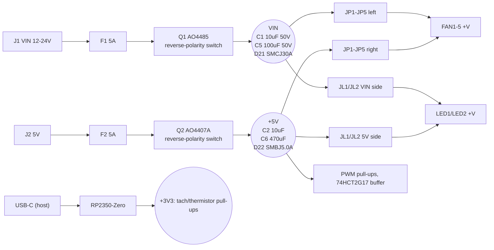

# Design notes

This page explains how the board works and why the parts were chosen. You don't need it to build or use the board. Each section starts with a short plain-language summary, and the details follow for anyone who wants them.

Schematic: [TinyFan2350-schematic.pdf](TinyFan2350-schematic.pdf). KiCad project: [`hardware/kicad`](../hardware/kicad) (KiCad 10).

## Safety margins

**In short:** every important part runs well below its maximum rating, even with a 24 V supply turned up to its 28.8 V limit and the board in a warm electronics bay. Datasheet maximums are not targets: real parts get hot, power supplies spike, and cheap parts vary. So the design follows the usual engineering rule of thumb and keeps voltage at or below about 80 % of each part's rating, current at or below about 75 %, and copper heating at or below about 20 °C at the recommended maximum load (the two main rails go slightly over that only right at the fuse limit; see [Copper](#copper-1-oz)).

Voltages are given at **24 V** and at **28.8 V**, which is the highest setting of a typical adjustable 24 V supply such as the Mean Well LRS-350-24. Currents are for the intended load: up to 5 fans at 0.6 A (3 A total).

### Voltage

| Part | What it is | Rating | Load at 24 V | Load at 28.8 V |
|---|---|---|---|---|
| Q4-Q8 **SI2308A** | Switch for 2/3-pin fans | 60 V | 40 % | 48 % |
| D7-D11 B5819W | Flyback diode across each fan | 40 V | 60 % | 72 % |
| F3-F7 PTC fuses | Self-resetting port fuses (they only see full voltage after they trip) | 33 V | 73 % | 87 % |
| D21 **SMCJ30A** | Input protection diode | 30 V stand-off | 80 % | 96 % (still below the point where it starts to conduct) |
| Q1 **AO4485** | VIN reverse-polarity switch | 40 V | 60 % | 72 % |
| Q1 gate | Held at 5.6 V by zener D23 | 20 V | 28 % | 28 % |
| Q2 **AO4407A** | 5 V reverse-polarity switch | 30 V | 17 % | - |
| C1 / C5 | VIN capacitors (ceramic / electrolytic) | 50 V | 48 % | 58 % |
| F1/F2 **Nano2 fuses** (Littelfuse 0452005.MRL) | Main fuses, soldered | 125 V | 19 % | 23 % |
| C6 / C2 | 5 V capacitors | 16 V / 50 V | 31 % / 10 % | - |
| 2N7002, 74HCT2G17, BAT54S | Signal parts on 3.3/5 V | 60 V / 7 V / 30 V | 8 % / 71 % / 17 % | - |

How the protection fits together: D21 starts to conduct between 33.3 V and 36.8 V. That is above any normal 24 V supply, but below the 40 V of the flyback diodes, the 40 V of Q1 and the 60 V of the fan MOSFETs. If something higher arrives (a wrong supply, a big spike), D21 shorts it and F1 blows before any other part reaches its limit. Power wired **backwards** never gets that far: Q1 / Q2 simply stay off (see [Power](#power)).

### Current and heat

| Part | Rating | Normal load | Margin |
|---|---|---|---|
| SI2308A switch, per fan | 3 A, 1.25 W | 0.6 A, about 0.03 W of heat | 20 % of current (0.6 A of 3 A), about 3 % of power |
| Fan port PTC (F3-F7) | 1.1 A hold | 0.6 A | 55 % cold (0.6 A of 1.1 A), about 75 % in a 60 °C bay |
| LED port PTC (F9/F10) | 2 A hold (about 1.5 A at 60 °C) | recommended max 1.5 A | 75 % |
| F1 VIN fuse (slow-blow) | 5 A | 3 A | 60 % |
| F2 5 V fuse (slow-blow) | 5 A | recommended max 3.5 A | 70 % |
| Q1 AO4485 (VIN switch) | 10 A | 3 A, about 0.2 W of heat | 30 % |
| Q2 AO4407A (5 V switch) | 12 A | 3.5 A, about 0.2 W of heat | 29 % |
| R65/R66 22k gate resistors | 0.125 W | 0.015 W at 24 V | 12 % (20 % at 28.8 V) |
| JST-XH connectors | 3 A per pin | 0.6 A fan, 1.5 A LED | 20 % / 50 % (0.6 A of 3 A / 1.5 A of 3 A) |
| 0805 resistors on VIN (R33-R39) | 0.125 W | 0.05 W at 24 V | 38 % (66 % at 28.8 V) |

### Copper (1 oz)

A script rebuilds every power net from the board file (tracks, vias, pads and the refilled pours on both layers), finds the widest path from each input to each load, sends every load's worst-case current back along it and turns each piece of copper into a temperature rise with the IPC-2221 method (outer layer, 1 oz). Worst case means all five fans at 0.6 A, both LED ports at 2 A, capped at the 5 A input fuse. Groups of vias share the current. Target: below 20 °C everywhere.

| Path | Narrowest copper | Rise at the recommended load | Rise at the fuse limit |
|---|---|---|---|
| Fan power and return, per port | 0.3 mm (most of it 0.4-0.6 mm) | 3.1 °C at 0.6 A | 12.4 °C at 1.1 A (PTC hold) |
| LED strip power, per port | 0.8 mm | 5.0 °C at 1.5 A | 9.6 °C at 2 A (PTC hold) |
| VIN: J1 -> F1 -> Q1 -> 2.5 mm trunk -> jumpers | 2.0 mm (Q1 -> C5) | - | 17.1 °C at 5 A |
| +5V: J2 -> F2 -> Q2 -> 2.5 mm trunk -> jumpers | 1.9 mm (Q2 pin tie) | - | 18.6 °C at 5 A |
| GND return (pours on both layers, 164 stitching vias) | 0.15 mm, 1 mm long, at the FAN1 switch | 9.8 °C at 0.6 A | - |

The VIN and +5V trunks (2.5 mm, both layers) were drawn by hand through the empty corridor between the fan columns and the thermistor row and locked before the rest was autorouted, so the router could never squeeze the high-current paths.


**v2.7 (history):** v2.7 is 3 mm wider and 6 mm taller than v2.6 (89 x 58.1 mm). The power section was rebuilt around that space: the VIN bus and the +5 V rail now run as wide copper areas on the bottom layer, so the top layer is free for an unbroken ground return. Every power path now stays **under 10 °C even at the 5 A fuse limit** (v2.6: about 25 °C). The one exception is a single short neck on the FAN4 power feed, next to its flyback diode, which reaches 11.5 °C at the full 1.5 A (v2.7 rating). That is still far below what the copper and the black solder mask can take (above 100 °C). The recommended maximums (4 A on VIN, 3.5 A on 5 V) now come only from fuse derating, not from copper heating.

### Known limits

- **+V shorted to a 12/24 V strip's DATA pin**: the 1k resistor (R19/R20) limits the current to about 23 mA at 24 V (27 mA at 28.8 V). If the 74HCT2G17 is driving the line low at that moment, the buffer sinks that current itself, close to its 25 mA limit, and R19/R20 dissipate about 0.5-0.75 W, well over their 0.25 W rating. Fix the short quickly; a long short can damage R19/R20 or U2. With 5 V strips there is no problem. (A smaller resistor would make this worse, see the LED data section.)
- **LED data cable length**: the 1k resistor plus the cable capacitance slows the data edges. In simulation (about 70 pF per metre of cable), a WS2812B '0' bit is still long enough at 1 m (276 ns, spec 220-380 ns) but too short at 2 m (195 ns) and 3 m (93 ns). Keep the data cable to about 1.5 m, or put the first LED (or a single 'sacrificial' pixel) within 1 m of the board. 470 ohm would allow 3 m but turns a +V-on-DATA mistake into a dead buffer.
- **Thermistor and EXP pins** connect to the RP2350 (GP26-GP29, GP14/GP15, plus the spare GP10/GP11 on EXP J5). Since v3.0 the thermistor wires have 10k series resistors (R67-R70): 28.8 V on a sensor wire drives only 2.5 mA into the ADC pin clamp (61 mW in the resistor), and the reading error stays ≤ 10 mV. The EXP pins are still straight to the RP2350: 12/24 V on one of them destroys the RP2350-Zero. It is socketed, so it is easy to swap. (J5 is 3.3 V logic only, not 5 V tolerant.)
- **24 V shorted to a fan's tach (RPM) pin**: the 10k resistor takes about 0.06 W at 28.8 V (about 51 % of its 0.125 W rating). It survives.
- **+V shorted straight onto a fan's PWM pin** is not protected. Pins 2 and 4 are not next to each other, so a bad crimp can't easily cause it.

## Schematic layout

**In short:** the schematic is split into pages by job. The fan page is drawn once and used five times.

| Sheet | File | What is on it |
|---|---|---|
| Root | `TinyFan2350.kicad_sch` | Overview: which RP2350 pin goes to which port |
| Power | `power.kicad_sch` | J1/J2, F1/F2 fuses, Q1/Q2 reverse-polarity switches, capacitors, protection diodes, power lights, mounting holes |
| MCU | `mcu.kicad_sch` | RP2350-Zero pin map, EXP header J5 (1x06: GND, 3V3, GP15, GP14, GP11, GP10) |
| FAN1..FAN5 | `fan_channel.kicad_sch` (one file, used 5 times) | Speed-signal booster, RPM input and its protection, fan socket, VIN/5V jumper, flyback diode, status light, 2/3-pin switch, port fuse |
| LEDs | `leds.kicad_sch` | 74HCT2G17 data booster, data protection, two LED ports with their jumpers and fuses |
| Thermistors | `thermistors.kicad_sch` | Four thermistor inputs (4.7k 1 % pull-up, 10k series resistor, 100 nF filter each) |

`VIN`, `+5V`, `+3V3` and `GND` are global power symbols. The root sheet only carries signals between the RP2350 and the ports. Inside a fan page the signals are named per port, for example `/FAN3/FAN_GND`. Each part keeps its board reference (R, Q, D, F number); the fan page has a table that maps FAN1..FAN5 to their numbers. Every fitted part carries its maker, maker part number and LCSC number.

## Power

**In short:** two separate inputs. Each has a fuse, a reverse-polarity switch and a protection diode. The RP2350-Zero is powered by its own USB cable.



- The RP2350-Zero's 5 V pin is not connected, so the USB 5 V and the J2 5 V can never feed into each other.
- VIN is not regulated on the board. Anything from 12 V to 24 V works (see the voltage table above).
- **Main fuses F1/F2:** Littelfuse Nano2 0452005.MRL, 5 A slow-blow, a small soldered SMD fuse (2410 size, about 6 x 2.7 mm). Slow-blow means the inrush when fans spin up won't blow it. It replaces the blade-fuse holders of v2.5 and saves a lot of board space. The trade-off: if one ever blows you have to solder in a new one. With the reverse-polarity switches below, it should only blow on a real fault (a short or the wrong supply).
- **Power wired backwards:** Q1 (VIN) and Q2 (5 V) are P-channel MOSFETs in the "ideal diode" arrangement. With correct polarity, the MOSFET's gate is pulled to GND by a 22k resistor (R65/R66), so it turns fully on and drops only about 0.05 V at 3 A. Wired backwards, the gate sees the wrong polarity and the MOSFET stays off: nothing flows, nothing blows, the board just does not turn on (the ON light stays dark). Fix the wiring and it works. A 5.6 V zener (D23/D24) keeps Q1's gate inside its 20 V limit on 24 V.
- **Too high a voltage** (for example 12 V or 24 V into the 5 V input): D21 (VIN) and D22 (5 V) sit right after the switches. They break down and short the rail, and they also absorb short spikes from the power supply. If a wrong supply lands on the 5 V input, D22 shorts the rail, but the 5 A slow-blow F2 takes 0.1 s to seconds to open — far longer than D22 is rated for. Expect to replace D22 **and** F2 (D22 normally fails short, so the rest of the board is protected).
- **Grounds:** J1 GND, J2 GND and the USB ground are joined on this board, as on every earlier version (the fans and LED strips need it). The board does not need any other ground link: in a printer where the Pi, 5 V and 24 V supplies already share a ground elsewhere, that is fine.
- Both copper layers have a solid GND pour, tied together by stitching vias. Small SMD ground pads connect solidly. Through-hole ground pins connect with four spokes, so a normal soldering iron can heat them.

## Fan speed signal (x5)

**In short:** the RP2350 speaks 3.3 V, and 4-pin fans expect 5 V, so a small MOSFET on each port converts it. If the RP2350 is unplugged, the fans run at full speed, which is the safe way to fail.

Each fan has its own 2N7002 (Q10-Q14 = FAN1-FAN5). The gate is tied to 3V3 and the source is on the GPIO, the classic two-way level shifter. The GPIO side is pulled up to 3V3 with 10k and the fan side to 5V with 2.2k (R47-R61; the 5 V pull-ups were lowered from 10k to 2.2k after the SPICE check, for faster edges — see the 2/3-pin mode section below). The logic is non-inverting. Fans have their own pull-up on PWM, so the result is an open-drain 5 V signal, as the Intel 4-wire fan spec expects.

## Fan mode: 4-pin or 2/3-pin (x5)

**In short:** a jumper picks how the fan is controlled. 4-pin fans get steady power and a speed signal. 2/3-pin fans have no speed wire, so the board switches their ground on and off instead.

Pin 1 of the fan socket (GND) goes to the MODE jumper JMx and to the drain of an SI2308A MOSFET (Q4-Q8). The MOSFET's source and the jumper's third pin are on GND. (Since v2.8 the port's PTC fuse is on the +V side, see [Port protection](#port-protection).)

- **JM on the bottom two pins (`4P`, 4-pin):** the jumper ties pin 1 straight to GND. The MOSFET is bypassed, and the fan is controlled by its PWM wire as above.
- **JM on the top two pins (`2/3`, 2/3-pin):** pin 1 only reaches GND through the MOSFET. Its gate is driven by the same 5 V PWM line, through a 1k resistor (R41-R45, lowered from 22k after the SPICE check) and clamped by a 5.6 V zener, so the PWM switches the fan's ground (like the Voron Klipper Expander). A B5819W Schottky across the fan catches the spike when it switches off. If the RP2350 is unplugged, the pull-up holds the gate on, so the fan runs at full speed, the same safe failure as 4-pin mode.
- The 2.2k pull-up and 1k gate resistor make the switch turn on in a few microseconds (the earlier 10k pull-up and 22k gate resistor took tens of microseconds, which was fine at 100 Hz but too slow for 25 kHz). With the faster drive the SI2308A's loss at 0.6 A / 25 kHz drops from 0.94 W to 0.06 W in the SPICE check, so 2/3-pin mode is now safe at any PWM frequency; the shipped config still sets `cycle_time: 0.010` for 2/3-pin ports (see `klipper/tinyfan.cfg`).
- **Why the SI2308A:** it is rated for 60 V, so on 24 V it runs at 40 % of its voltage rating (the AO3400A used before v2.5 was rated 30 V, which is 80 % at 24 V and 96 % at 28.8 V). It has 95 mΩ at 4.5 V gate drive, so a 0.6 A fan heats it by only about 0.03 W. Same SOT-23 size and pin order (1 G, 2 S, 3 D).
- The status light (10k from the fan's +V to pin 1) is on whenever the port has power. In 2/3-pin mode it follows the fan speed. It is dim on 5 V fans and bright on 24 V fans.

## Port protection

**In short:** a badly crimped cable should kill a fan at worst, never the board.

- **Fan ports:** each port's +V goes through a **1.1 A / 33 V** PTC (F3-F7, LUTE 1812L110/33GR), between the VIN/5V jumper JPx and pin 2 of the fan socket. Because the fuse is on the +V side (since v2.8), it also catches a +V wire chafing against the printer frame or any other grounded metal, not just a short between the fan's own wires. It carries a 0.6 A fan continuously even in a warm bay (55 % of the 1.1 A hold, about 75 % at 60 °C), and trips a dead short (tens of amps) in well under a second, so only that port switches off. It resets once the short is gone and it cools.
- **Fan MOSFET gates:** R41-R45 (1k, lowered from 22k for the faster drive) plus BZT52C5V6 zeners (D13-D17). A fan wired with its power reversed can push the PWM line well above 5 V; the zener keeps the gate under its 20 V limit.
- **RPM (tach) lines:** 10k in series (R21-R25, 4.7k before v2.8) plus a BAT54S clamp to 3V3, so even 28.8 V on a tach pin only lets about 2.5 mA through and the resistor stays at about half its rating.
- **LED ports:** a **2 A / 33 V** PTC (F9/F10, LUTE 1812L200/33GR) between the VIN/5V jumper JLx and each strip's +V pin (since v2.8; before it was in the return), plus the data protection below.
- **Inputs:** see [Power](#power).

## LED strip power (x2)

JL1/JL2 connect each LED socket's pin 2 to VIN (top two pins) or 5 V (bottom two pins). Data is always the 5 V buffer output. Use 12 V strips such as WS2815 on a 12 V supply, and 24 V strips only on a 24 V supply (a WS2815 on a 24 V VIN jumper dies). The strip power tracks are 0.8 mm or wider (see the copper table).

## Fan RPM (tach) input (x5)

```
FAN TACH (XH pin 3) --+-- 10k (R51/R52, R57/R58, R63) --> 3V3
                      |
                      +-- 10k ---+--> GPIO
                                 |
                          BAT54S clamp to GND and 3V3
```

The fan's tach output is open collector, pulled up to 3V3 on the board. The 10k resistor and the clamp diodes limit the current into the RP2350 to a few mA if a miswired fan puts VIN on the tach wire.

The RP2350 has a known chip bug (erratum E9): a GPIO input can latch at about 2 V when the signal is weak. The 10k pull-up drives the line hard enough that this doesn't happen here.

## LED data (x2)

**In short:** the RP2350's 3.3 V data is boosted to 5 V so long strips read it reliably, and the line is protected against mistakes.

One 74HCT2G17 dual buffer, powered from 5 V, drives both ports. HCT inputs switch below 2 V, so they read 3.3 V reliably, and the outputs swing the full 5 V. Each input has a 10k pull-down (R31/R32), so the strips stay dark while the RP2350 is unplugged or starting. A 1k resistor (R19/R20) damps ringing on long cables, and a BAT54S (D19/D20) clamps the buffer side to 0-5 V. If +V touches the data pin, the current is limited to about 19 mA even at 24 V (see [Known limits](#known-limits)).

## Thermistors (x4)

4.7k 1 % pull-up (R27-R30, now 1206) to 3V3 and 100 nF to GND at the ADC pin, with the 100k NTC thermistor to GND through the connector. New in v3.0: a 10k series resistor (R67-R70) between each divider node and the RP2350 ADC pin. If 28.8 V touches a sensor wire it drives only 2.5 mA into the pin clamp, with 61 mW in the resistor; the reading error stays ≤ 10 mV even with 1 uA worst-case pin leakage (about 0.4 °C at 100 °C). The ADC pins are GP26-GP29. Klipper sets them as analog inputs with the digital input off, so erratum E9 does not affect them.

## Track corners and EMI

Right-angle track corners are often said to cause interference (EMI). That only matters at multi-GHz signal speeds. The fastest signal here is the 800 kHz LED data (the fan PWM is 25 kHz). What matters on this board is a clean ground return, so it has solid ground pours under the signal tracks and stitching vias between the top and bottom grounds. Right-angle corners were still cut to 45° wherever there was room.

## Changes from the original TinyFan

| | TinyFan (Gi7mo) | TinyFan2350 v2.7 |
|---|---|---|
| MCU | RP2040-Zero | RP2350-Zero (same footprint and pinout), socketed |
| Input | 24 V + on-board converter | Separate 12-24 V and 5 V inputs, each with a fuse, a reverse-polarity switch and a protection diode |
| Fans | 2/3/4-pin, fixed voltage | 6 x JST-XH, VIN/5V jumper per port, 4-pin PWM or switched 2/3-pin, RPM input with protection, self-resetting fuse per port |
| LEDs | - | 2 x addressable LED ports, 5 V data, 5 V or VIN strip power |
| Sensors | - | 4 x thermistor ports |
| Size | ~60 x 62 mm | 89 x 58.1 mm |

**v3.0 (this revision, on top of v2.7):**

- FAN6 removed: 5 fan ports FAN1-FAN5 (was 6); fan switches Q4-Q8 and level shifters Q10-Q14 (Q9 and Q15 no longer exist).
- Recommended maximum per port 0.6 A (was 0.8 A); fan power tracks 0.4 mm.
- Port PTCs F3-F7 LUTE 1812L110/33GR, 1.1 A hold / 33 V (was F3-F8 LUTE 1812L150/33GR, 1.5 A).
- EXP J5 now 1x06: 1 GND, 2 3V3, 3 GP15, 4 GP14, 5 GP11, 6 GP10. 3.3 V logic only, not 5 V tolerant; GP10/GP11 are spares freed by removing FAN6.
- Faster fan gate drive (after the SPICE check): gate resistors R41-R45 22k -> 1k, PWM-5V pull-ups R49/R50/R55/R56/R61 10k -> 2.2k. The SI2308A loss at 0.6 A / 25 kHz drops from 0.94 W to 0.06 W, so 2/3-pin mode is safe at any PWM frequency.
- Thermistors: new 10k series resistors R67-R70 (28.8 V on a sensor wire: 2.5 mA into the pin clamp, 61 mW in the resistor, reading error ≤ 10 mV); pull-ups R27-R30 now 1206.
- SMD placement: all SMD parts on the bottom side (one-side assembly), except the top-side indicator LEDs LD1-LD5 (fan LEDs) and LD7/LD8 (power ON); LD6 no longer exists.

## Verification

v3.0 checks (all on the committed files):

- **ERC** (electrical check): 0 errors.
- **DRC** (layout check, KiCad 10.0.8, all severities, pours refilled): 0 errors, 0 warnings, nothing unconnected, schematic parity clean.
- **Copper current check**: every power path below 20 °C at the worst case (table above).
- **SPICE** (ngspice): reverse-polarity FETs; fan switch at 0.6 A in 4-pin and 2/3-pin mode (SI2308A loss 0.06 W at 25 kHz with the 1k / 2.2k gate drive, 0.02 W at 100 Hz); tach input with a 28.8 V fault; thermistor input with a 28.8 V fault (2.5 mA into the pin clamp, 61 mW in R67-R70, 138 mW in R27-R30) and reading error (<= 10 mV with 1 uA worst-case leakage, about 0.4 °C at 100 °C); LED data line (1k series: up to about 1.5 m of cable). Behavioural models were used for the PTCs and TVS diodes.
- **Klipper**: the RP2350 firmware dictionary was built from Klipper source and klippy ran the config in batch mode, with the default sensors and with all four thermistors enabled; both configure the MCU with no errors.
- **Mechanics**: the DIN tray's 8.5 mm standoffs were checked against every bottom-side part and through-hole pin; the tray has small relief pockets where parts come within 0.3 mm.
- **Independent review**: the local AI reviewed the final files on its own; its findings were settled against the files (see CHANGELOG).

Reference numbers have gaps on purpose: parts removed with FAN6 (Q9, Q15, D6, D12, D18, F8, R26, R38, R46, R60, R62, R64, LD6, FAN6, JM6, JP6) keep their numbers free, and Q3 was never used.

## Bring-up checklist (first board)

A simulation is not proof. Before connecting fans or strips:

1. **No power, multimeter:** VIN to GND and 5 V to GND not shorted (> 1 kΩ); J1/J2 polarity matches the `-` / `+` marks.
2. **5 V only (J2), current-limited supply at 0.2 A:** both ON lights; Q2 drop below 0.1 V; reversing J2 does nothing (no current).
3. **12-24 V only (J1), current-limited at 0.2 A:** VIN ON light; Q1 drop below 0.1 V; reversing J1 does nothing.
4. **RP2350-Zero in its sockets, USB to the Pi:** flash Klipper, `[mcu tinyfan]` connects; TH1-TH4 read room temperature with 100k NTCs (an open input reads very cold).
5. **One fan per port, JM on 4P, JP on the fan's voltage:** speed follows `SET_FAN_SPEED`, RPM reads, the port LED lights. Then a 2/3-pin fan with JM on 2/3 and `cycle_time: 0.010`.
6. **One LED strip per port, JL on the strip's voltage:** colours follow `SET_LED`; strips stay dark while the board starts.
7. **Heat check after 30 min at full load:** no part of the board noticeably warmer than the fans' own connectors.
