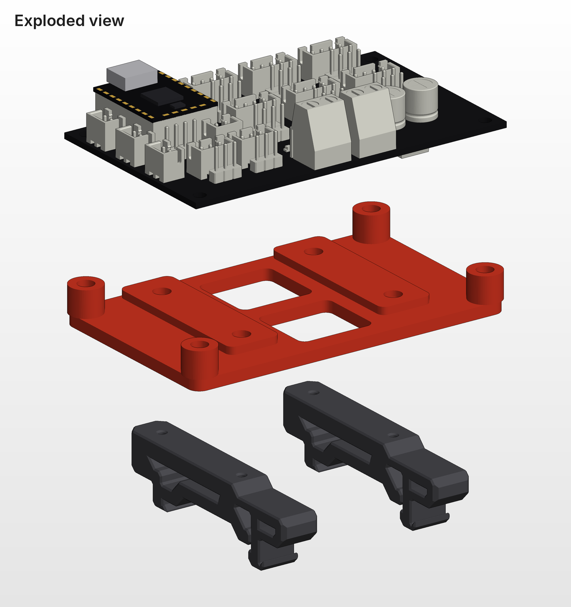

# DIN rail mount

A 3D-printed tray that holds the TinyFan2350 on a **DIN rail** (the metal rail in most printer electronics bays). It clips on with **two Voron Trident PCB DIN clips** (`pcb_din_clip`, the same clips the Voron Trident uses for its other boards).

| | |
|---|---|
| Printed part | [`mechanical/TinyFan2350_DIN_mount.stl`](../mechanical/TinyFan2350_DIN_mount.stl) (STEP + CadQuery source alongside) |
| Footprint | 86 x 52 mm, the same as the PCB. The clip latches stick out about 10 mm past the screw-terminal edge, under the tray. About 43 mm from the bottom of the clips to the top of the screw terminals |
| PCB height | Board underside sits 10 mm above the clips (7 mm standoffs on a 3 mm plate) |
| Clip spacing | 42 mm centre-to-centre along the rail |

## Parts

| Qty | Part | Notes |
|---|---|---|
| 1 | Printed mount | |
| 2 | Voron Trident PCB DIN clip | [VoronDesign/Voron-Trident `STLs/ElectronicsBay`](https://github.com/VoronDesign/Voron-Trident/tree/main/STLs/ElectronicsBay) |
| 4 | M2x10 self-tapping screw | Mount → clips (part of the Voron BOM). M2x12 also fits and grips better |
| 4 | M3 heat-set insert, 4.8 mm outside diameter x 4 mm long (Robu M3x4) | Melted into the posts with a soldering iron (4.3 mm holes). For Voron-style 5 mm inserts set `INS_D=4.6` in the .py and re-export |
| 4 | M3x6 screw, button head (BHCS) or socket head (SHCS) | PCB → mount |

## Print settings

- ABS/ASA (it lives in the electronics bay), Voron defaults: 0.2 mm layers, 4 walls, 5 top/bottom layers, 40% infill.
- Print it **flat side down** as exported. No supports needed. The only bridge is the 0.5 mm-deep clip pocket on the underside.

## Assembly

1. Heat each M3 insert with your soldering iron (about 220-250 °C) and press it gently straight down into a post, flush with the top.
2. Put the two DIN clips into the 0.5 mm locating pockets on the underside. The **latch end** of each clip (the springy end with the release tab) goes towards the board edge with the **screw terminals** (J1/J2).
3. Screw each clip on from the top with 2 x M2x10 self-tappers. The screw heads sit flush in the raised pads.
4. Fit the PCB, USB-C end towards the far edge from the latches, using 4 x M3x6.
5. Hook the fixed end of the clips onto the rail, then press the latch side down until it snaps. To remove it, pull the latch tab with a flat screwdriver.

## Design notes

- The geometry was measured from the Voron Trident PCB DIN clip STEP: a 41.5 x 10 mm flat top face, and two Ø1.9 mm pilot holes 31.5 mm apart for M2 self-tappers.
- The clip axis is across the rail and the board's long side runs along it. That way the board uses 86 mm of rail, and the two clips make a stable 42 mm wide base.
- 7 mm of clearance under the PCB covers untrimmed through-hole leads (JST-XH pins stick out about 3.4 mm). The board's full 3D model was checked against the tray: nothing touches.
- The open windows let air through, and you can reach the clip screws without removing the clips.
- To change anything (standoff height, insert size, clip spacing), edit the parameters at the top of `TinyFan2350_DIN_mount.py` and run it with CadQuery 2.x. It writes the STEP and STL.

