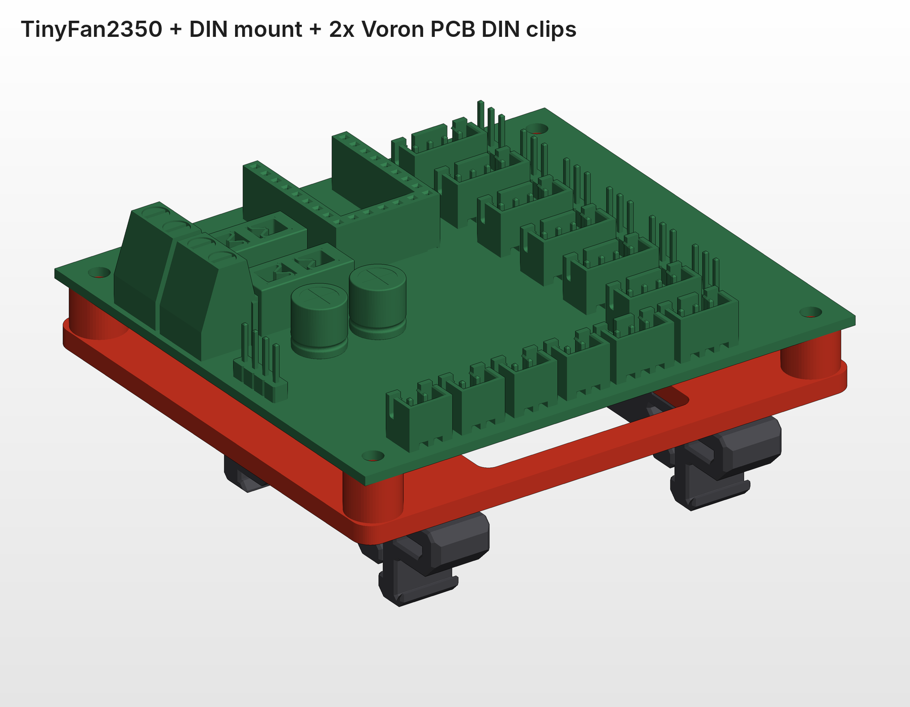
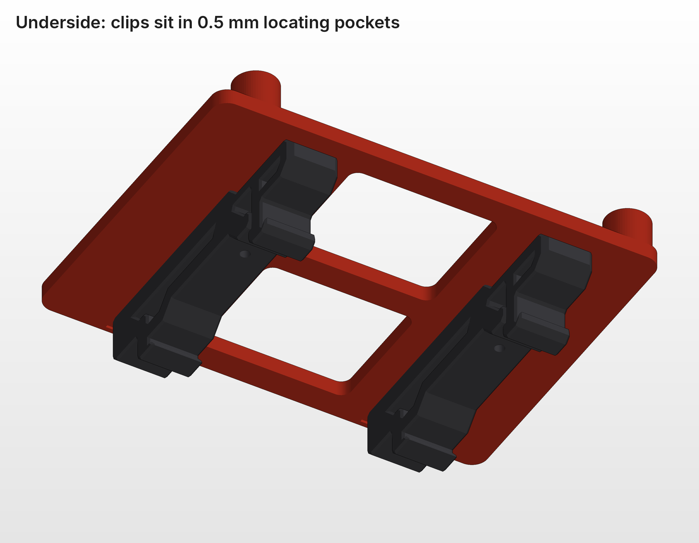
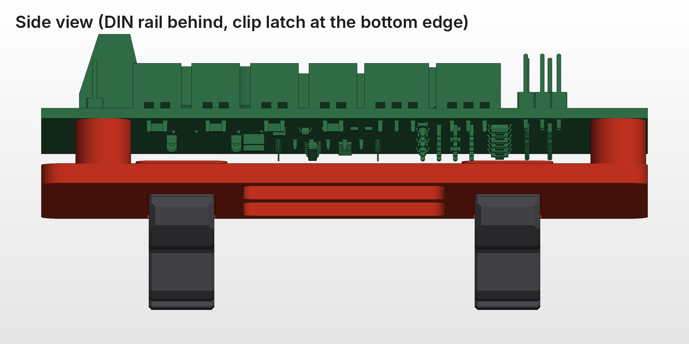

# DIN rail mount

A 3D-printed tray that holds the TinyFan2350 on a **DIN rail** (the metal rail in most printer electronics bays). It clips on with **one Voron Trident PCB DIN clip** (`pcb_din_clip`, the same clip the Voron Trident uses for its other boards). The board sits **across** the rail: its long side (89 mm) points away from the rail, and it uses only 58 mm of rail length.

| | |
|---|---|
| Printed part | [`mechanical/TinyFan2350_DIN_mount.stl`](../mechanical/TinyFan2350_DIN_mount.stl) (STEP + CadQuery source alongside) |
| Footprint | 89 x 58.1 mm, the same as the PCB. The whole clip, latch included, is centred under the tray, about 13.5 mm in from each end, so nothing sticks out past the outline. About 43 mm from the bottom of the clip to the top of the screw terminals |
| PCB height | Board underside sits 10 mm above the clip (7 mm standoffs on a 3 mm plate) |
| Rail use | 58.1 mm along the rail (the board's short side) |

## Parts

| Qty | Part | Notes |
|---|---|---|
| 1 | Printed mount | |
| 1 | Voron Trident PCB DIN clip | [VoronDesign/Voron-Trident `STLs/ElectronicsBay`](https://github.com/VoronDesign/Voron-Trident/tree/main/STLs/ElectronicsBay) |
| 2 | M2x10 self-tapping screw | Mount → clip (part of the Voron BOM). M2x12 also fits and grips better |
| 4 | M3 heat-set insert, 4.8 mm outside diameter x 4 mm long (Robu M3x4) | Melted into the posts with a soldering iron (4.3 mm holes). For Voron-style 5 mm inserts set `INS_D=4.6` in the .py and re-export |
| 4 | M3x6 screw, button head (BHCS) or socket head (SHCS) | PCB → mount |

## Print settings

- ABS/ASA (it lives in the electronics bay), Voron defaults: 0.2 mm layers, 4 walls, 5 top/bottom layers, 40% infill.
- Print it **flat side down** as exported. No supports needed. The only bridge is the 0.5 mm-deep clip pocket on the underside.

## Assembly

1. Heat each M3 insert with your soldering iron (about 220-250 °C) and press it gently straight down into a post, flush with the top.
2. Put the DIN clip into the 0.5 mm locating pocket on the underside. The **latch end** (the springy end with the release tab) goes towards the board's **right edge** (the LED ports LED1/LED2), away from the USB-C and power inputs.
3. Screw the clip on from the top with 2 x M2x10 self-tappers. The screw heads sit flush in the raised pad.
4. Fit the PCB with the USB-C end (U1, on the left edge) at the edge away from the latch, using 4 x M3x6.
5. Hook the fixed end of the clip onto the rail, then press the latch side down until it snaps. To remove it, pull the latch tab with a flat screwdriver.

## Design notes

- The geometry was measured from the Voron Trident PCB DIN clip STEP: a 41.5 x 10 mm flat top face, and two Ø1.9 mm pilot holes 31.5 mm apart for M2 self-tappers.
- Since v2.7 the board is turned 90° on the rail: the clip runs across the rail along the board's long side, so a single clip carries it and the board takes only 58 mm of rail. The whole clip (fixed hook to latch tab) is centred under the board, so the weight sits evenly over the rail. (v2.6 used two clips with the board's long side along the rail.)
- 7 mm of clearance under the PCB covers untrimmed through-hole leads (JST-XH pins stick out about 3.4 mm). The board's full 3D model was checked against the tray: nothing touches.
- The open windows let air through, and you can reach the clip screws without taking the clip off.
- To change anything (standoff height, insert size, clip position), edit the parameters at the top of `TinyFan2350_DIN_mount.py` and run it with CadQuery 2.x. It writes the STEP and STL.

