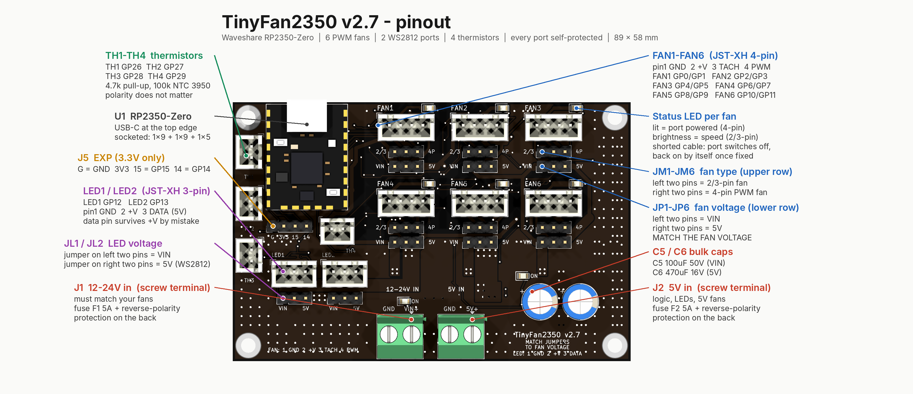

# Wiring guide

**Do the jumpers first, plug things in second, switch on last.** A wrong jumper is the one mistake that can destroy a fan or an LED strip.

## 1. Power

The board has three power inputs:

| Input | Connect it to | Fuse | It powers |
|---|---|---|---|
| **J1: VIN 12-24 V** | Your printer's main power supply (12 V or 24 V) | F1, 5 A mini blade | Fans and LED strips whose jumper is set to **VIN** |
| **J2: 5 V** | A 5 V power supply or a 5 V buck converter | F2, 5 A mini blade | 5 V fans, 5 V LED strips, and the signal boosters on the board |
| **USB-C on the RP2350-Zero** | Your Klipper host (Raspberry Pi etc.) | - | The RP2350-Zero itself |

**How to connect J1 and J2**

- The board labels each screw: **GND**, **VIN+** (J1) and **5V+** (J2). On both terminals the **top screw is GND**.
- Use wire of at least **0.5 mm² (20 AWG)**.
- Connect GND of both supplies together at one point (normally your power supply's V- terminal). All grounds on the board are joined, including the USB ground.
- The board does **not** convert voltage. Whatever you feed into J1 goes straight to the fan jumpers.
- **Wired it backwards?** The board is protected. A protection diode (D21 on J1, D22 on J2) shorts the wrong voltage and the fuse for that input blows. Fix the wiring, then put in a new 5 A fuse. The same happens if you put 12/24 V into the 5 V input by mistake.

### How much can it power?

These limits keep every part comfortably below its maximum, including in a warm electronics bay:

| What | Recommended maximum | Hard limit (fuse) |
|---|---|---|
| All fans and strips on **VIN** together | **4 A** (for example 3 fans at 0.8 A + 3 fans at 0.2 A = 3 A) | 5 A (F1) |
| Everything on **5 V** together | **3.5 A** | 5 A (F2) |
| **One fan port** | **1 A** | 1.5 A (self-resetting) |
| **One LED port** | **1.5 A** | 2 A (self-resetting) |

A 5 V WS2812 strip uses up to about 60 mA per LED at full white. 25 LEDs at full white is already 1.5 A, so set a brightness limit in Klipper for long strips (or use a 12 V strip on VIN).

## 2. Fans (FAN1-FAN6)

The fan sockets are **JST-XH 4-pin** (2.5 mm). Normal PC fan plugs **do not fit**: put JST-XH (XHP-4) housings on your fan wires.

| XH pin | Signal | Usual PC fan wire colour |
|---|---|---|
| 1 | GND (-) | black |
| 2 | + power (VIN or 5 V, from the jumper) | red, or yellow on 12 V PC fans |
| 3 | TACH (RPM signal) | green or yellow |
| 4 | PWM (speed signal) | blue |

Colours vary between makers, so check your fan's datasheet.

### Set two jumpers for every fan port

Next to each fan socket are two 3-pin jumpers. Put one cap on each, on either the top pair or the bottom pair.

| Jumper | Cap on the **top** two pins | Cap on the **bottom** two pins |
|---|---|---|
| **MODE** (JM, left) | 2-pin or 3-pin fan | 4-pin PWM fan |
| **FAN V** (JP, right) | **VIN** (the 12 V or 24 V on J1) | **5 V** |

No cap on FAN V means that port gets no power.

> **Match FAN V to the voltage printed on the fan.** A 12 V fan on 24 V overheats and dies. A 5 V fan on VIN dies straight away.

**Which MODE?**

- **4-pin fan** (4 wires): MODE on the **bottom**. The fan gets steady power, and its blue wire sets the speed. You also get RPM.
- **2-pin fan** (red and black only, like most Voron 4010/5015/6015 fans): MODE on the **top**. Crimp the black wire to **pin 1** and the red wire to **pin 2**. The board switches the fan on and off quickly to set the speed. In Klipper use `cycle_time: 0.010` for that fan (it is already in `klipper/tinyfan.cfg`).
- **3-pin fan**: MODE on the **top**, wires on pins 1-3. Speed control works, but the RPM reading is not reliable in this mode, so leave `tachometer_pin` out of the config.
- Got MODE wrong? Nothing breaks. A 2-pin fan on the bottom setting just runs at full speed, and a 4-pin fan on the top setting runs roughly until you move the cap.

**Green light next to each fan:** it is on when that port has power. With a 2/3-pin fan it gets brighter as the fan speeds up. It is dim on 5 V fans.

**Shorted cable?** Each fan port has its own self-resetting fuse. If a bad crimp shorts + to -, only that port switches off and its fan stops. Unplug it, fix the cable, wait about a minute, and the port works again. Nothing to replace.

## 3. LED strips (LED1, LED2)

The LED sockets are JST-XH 3-pin: **1 GND, 2 + power, 3 DATA**.

The **LED V** jumper for each port (JL1 for LED1, JL2 for LED2, bottom right corner) chooses the strip's power:

| JL cap on | Strip gets | Use it for |
|---|---|---|
| **Left two pins (VIN)** | the 12 V or 24 V on J1 | 12 V / 24 V addressable strips, such as WS2815 |
| **Right two pins (5 V)** | 5 V from J2 | WS2812B, SK6812 and other 5 V strips |

> **A 5 V strip on VIN is destroyed at once. Check the LED V jumper before you plug a strip in.**

The DATA signal is always 5 V. That suits 5 V strips, and 12 V/24 V strips such as the WS2815 also accept it. If you use an unusual 12/24 V strip, check its datasheet says it accepts 5 V data.

The data line is protected. A long wire to the first LED is fine, and if + touches DATA by mistake on a 5 V strip, nothing is damaged. With a 12/24 V strip, fix such a short quickly, because the small protection resistor gets hot.

## 4. Thermistors (TH1-TH4)

JST-XH 2-pin: **pin 1 = signal, pin 2 = GND**. Thermistors have no + or -, so either way round works. Use standard **100k NTC** thermistors ("Generic 3950" in Klipper). The board already has the resistor Klipper expects (4.7k), so you don't add anything.

| Port | RP2350 pin |
|---|---|
| TH1 | GP26 |
| TH2 | GP27 |
| TH3 | GP28 |
| TH4 | GP29 |

**3.3 V only.** Never connect anything with 5 V or more to these ports.

## 5. EXP header (J5, optional)

Pins: **1 GND, 2 3.3 V, 3 GP15, 4 GP14**. Uses: a door switch, a filament sensor, an I2C sensor (GP14 = SDA, GP15 = SCL), or one small extra LED strip data line. **3.3 V signals only**, and draw no more than about 100 mA from the 3.3 V pin.

## 6. Mounting holes

Four M3 holes on an **86 x 54 mm** rectangle, 4.5 mm in from the top, bottom and right edges and 9.5 mm from the left edge (the screw-terminal side), seen from the top. The holes are connected to GND. Leave about 20 mm of space above the board for the fuses. For DIN rail mounting see [mounting.md](mounting.md).
